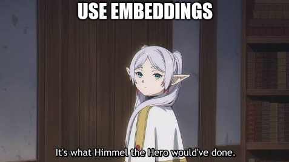

# Embedding-based Anime Recommendation System



A content-based anime recommender built on feature engineering and text embeddings. Every anime in a public MyAnimeList dataset is turned into a numeric vector, and recommendations are the anime whose vectors are closest by cosine similarity.

Author: [Amable Valdés](https://github.com/Amable-Valdes)

## Table of contents

- [About the project](#about-the-project)
- [What the notebook does](#what-the-notebook-does)
- [Repository structure](#repository-structure)
- [Getting started](#getting-started)
- [Running the notebook](#running-the-notebook)
- [Example output](#example-output)
- [Limitations](#limitations)
- [Related project](#related-project)
- [License](#license)

## About the project

The idea is to capture something I have always liked: once data is transformed into embeddings, classification-style problems become points in a space where other operations, such as finding neighbours, become simple and useful.

The notebook uses the [Anime Data Set for ML](https://www.kaggle.com/datasets/wiltheman/anime-data-set-for-ml) (about 65k anime from MyAnimeList) to build a **content-based recommender**. Given an anime you have watched, it returns the anime that are most similar according to their features and synopsis.

The project is an experiment and a learning exercise. The feature-engineering decisions are my own and are not the only reasonable choices; each section of the notebook explains why a column was handled the way it was.

## What the notebook does

1. **Loads the dataset** with [`kagglehub`](https://pypi.org/project/kagglehub/), which downloads the public dataset automatically.
2. **Explores the original data** (title, dates, status, genres, themes, demographics, rank, score, synopsis, etc.).
3. **Engineers each feature** into a numeric representation:

   | Column(s) | Transformation |
   | --- | --- |
   | Image | Dropped |
   | Aired from / to | Mapped into era labels (label encoding) |
   | Status | One-hot encoding |
   | Demographics | Multi-hot encoding |
   | Themes, genres, rating | Multi-hot encoding |
   | Episodes | Kept as is |
   | Rank, popularity, members, favorites, score, scored by | Numeric transformations (scaling and inversion of rank) |
   | Title, English title, Japanese title | Dropped |
   | Synopsis | Text embedding (see below) |

4. **Handles missing values** in rank and score.
5. **Embeds the synopsis** with a text model. Three options are discussed in the notebook (TF-IDF / Bag of Words, Sentence Embeddings, and LLM embeddings). The notebook uses Sentence Embeddings with [`sentence-transformers/all-MiniLM-L6-v2`](https://huggingface.co/sentence-transformers/all-MiniLM-L6-v2), which produces 384-dimensional vectors.
6. **Builds the final embedding** by concatenating the engineered features and the synopsis embedding. The result has shape `(29153, 479)`: 479 components per anime.
7. **Recommends similar anime** with cosine similarity, for example the 10 closest anime to a chosen title.
8. **Saves the result** to `embeddings_df.csv` in the working directory.

## Repository structure

```text
.
├── anime-recommendation-system-based-on-embeddings.ipynb  # Main notebook (the whole project)
├── execution_in_markdown.md                               # Notebook exported to Markdown, with all outputs
├── requirements.txt                                       # Python dependencies
├── resources/                                             # Images used in the notebook
└── README.md
```

`execution_in_markdown.md` is an export of the notebook, including its outputs, so you can read the results without running anything.

## Getting started

### Requirements

- Python 3.14 (the versions in `requirements.txt` were tested with this release)
- An internet connection the first time you run the notebook, to download the dataset
- Several GB of disk space for PyTorch and the sentence-transformers model

No Kaggle account or API token is needed; the dataset is public.

Just a quick note: I created this notebook years ago, back when I was using Python 3.12. While tidying up my public repositories, I realized this one was in pretty bad shape, so I ran it using Python 3.14—everything is now tested and verified for 3.14. In theory, it should also work fine on 3.12, though the dependencies listed in the `requirements` file would likely differ. Long story short: it works for me on 3.14! Haha.

### Installation

```bash
git clone https://github.com/Amable-Valdes/ai-anime-recommendation-system-example.git
cd ai-anime-recommendation-system-example

python -m venv .venv
source .venv/bin/activate        # Windows: .venv\Scripts\activate
pip install -r requirements.txt
```

The requirements install the default PyTorch build. On a machine without a GPU, you can install the smaller CPU-only build of PyTorch first from the [PyTorch index](https://pytorch.org/get-started/locally/).

## Running the notebook

Start Jupyter from the project folder and open the notebook:

```bash
jupyter notebook anime-recommendation-system-based-on-embeddings.ipynb
```

Then choose **Run → Run All Cells**.

Or run it from the command line without opening the browser:

```bash
jupyter nbconvert --to notebook --execute \
  --ExecutePreprocessor.timeout=1200 \
  anime-recommendation-system-based-on-embeddings.ipynb \
  --output executed.ipynb
```

Notes:

- The first cell downloads the dataset into `~/.cache/kagglehub/` and prints the path. Later runs reuse the cached copy.
- The synopsis embedding step downloads the `all-MiniLM-L6-v2` model from Hugging Face the first time it runs.
- The notebook writes `embeddings_df.csv` (about 145 MB) into the project folder. It is regenerated on every run and is not meant to be committed.
- Some cells contain Kaggle-specific comments (`/kaggle/input`, `/kaggle/working`). They are harmless when running locally.

## Example output

The notebook ends by printing the 10 closest anime for a few queries. For example, the closest neighbours of *Cowboy Bebop* start with *Bubblegum Crisis Tokyo 2040*, *Kidou Senshi Gundam SEED* and *Trigun*. For *Monster*, they start with *Maison Ikkoku*, *Warau Salesman* and *Gekitou! Crush Gear Turbo*. Full outputs are in [`execution_in_markdown.md`](execution_in_markdown.md).

## Limitations

- **No evaluation metric.** The recommendations look reasonable on inspection, but there is no benchmark, mean average precision, or user study to measure them. I specify this explicitly in the notebook.
- **Feature choices are subjective.** Dates, episodes and rank are handled in simple ways that could be improved.
- **Content only.** This example does not use user ratings or watch history, so it cannot personalise beyond the anime you give it.
- **Dataset age.** The dataset is an older snapshot of MyAnimeList. It is from 2025, but time pass. Keep this in mind when searching for content in the dataset, because if it’s very recent, it might not be there ;)

## Related project

The notebook prepares the data for a vector database. The companion project [milvus-using-anime-example](https://github.com/Amable-Valdes/milvus-using-anime-example) shows how the same kind of embeddings could be stored and searched in [Milvus](https://milvus.io/), where cosine similarity search is built in.

## License

This is an example of a scientific method, and as such, it is not owned by anyone.

However, the specific notebook and the files provided here are copyrighted by me—in other words, they belong to me.

That said, if you’d like to work on a project inspired by what I’ve done here, feel free to copy the code or other elements. No problem at all! ;)

## Acknowledgements

- [wiltheman](https://www.kaggle.com/wiltheman) for the [Anime Data Set for ML](https://www.kaggle.com/datasets/wiltheman/anime-data-set-for-ml) on Kaggle.
- [MyAnimeList](https://myanimelist.net/) as the original source of the data.
- [Sentence-Transformers](https://www.sbert.net/) and the [all-MiniLM-L6-v2](https://huggingface.co/sentence-transformers/all-MiniLM-L6-v2) model.
