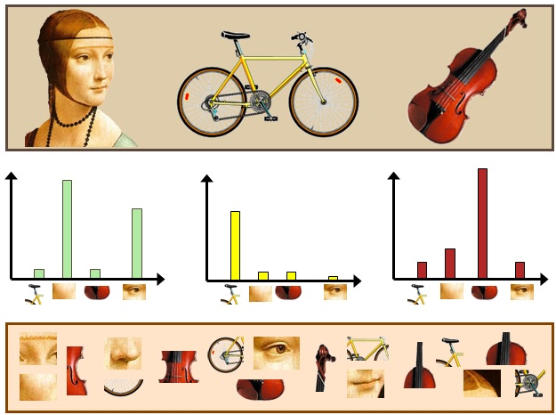

```python
# IMPORTANT: RUN THIS CELL IN ORDER TO IMPORT YOUR KAGGLE DATA SOURCES,
# THEN FEEL FREE TO DELETE THIS CELL.
# NOTE: THIS NOTEBOOK ENVIRONMENT DIFFERS FROM KAGGLE'S PYTHON
# ENVIRONMENT SO THERE MAY BE MISSING LIBRARIES USED BY YOUR
# NOTEBOOK.
import kagglehub
wiltheman_anime_data_set_for_ml_path = kagglehub.dataset_download('wiltheman/anime-data-set-for-ml/versions/1')

print('Data source import complete.')
```

    Data source import complete.


    /home/amable/Desktop/GIT/ai-anime-recommendation-system-example/.env/lib/python3.12/site-packages/tqdm/auto.py:21: TqdmWarning: IProgress not found. Please update jupyter and ipywidgets. See https://ipywidgets.readthedocs.io/en/stable/user_install.html
      from .autonotebook import tqdm as notebook_tqdm


<a id="section-1"></a>
# Embedding-based anime recommendation system
by Amable Valdés

In this work, I wanted to capture an idea I've always loved: transforming data into embeddings and convert our classification problems to a cluster where you can do other kind of operations that can be useful. 

In this document, I'll use this anime dataset to create a recommendation system based on content filtering. This way, we'll convert each anime into an embedding and then, using cosine similarity, search for the vectors closest to the vectors of the anime we have watched. That way we will have recomendations based on the previous content we have watched.

I had to do a lot of feature engineering to process the dataset. In each section, I have written explanations of why I made each decision in the processing of each feature, and I must say that my logic is not absolute. At the end (spoiler!!! hahaha) it shows that the system seems to work well and gives good recommendations, but after reading this document, you might have other opinions about how a feature could have been processed and how it could have performed better. Leave a comment in this case: we all like to learn from other people and other points of view :)

<a id="section-2"></a>
# Table of Contents
* [Embedding-based anime recommendation system](#section-1)
* [Table of Contents](#section-2)
* [Kaggle data load](#section-3)
* [Original dataset](#section-4)
* [Feature Engineering](#section-5)
    * [Image -> Delete](#section-6)
    * [Aired_from, Aired_to -> Label encoding](#section-7)
    * [Status -> One-hot encoding](#section-8)
    * [Demographics -> Multi-hot encoding](#section-9)
    * [Themes, Gender and Rating -> Multi-hot encoding](#section-10)
    * [Episodes -> Fix type](#section-17)
    * [Rank, Popularity, Members, Favorites, Score and Scored_by -> Numeric transformations](#section-12)
    * [Title, Title_English, Title_Japanese -> Delete](#section-13)
    * [Synopsis -> Text embedding vector](#section-14)
        * [Bag of Words (BoW)](#section-15)
        * [Sentence Embeddings](#section-16)
        * [Large Language Model Embeddings](#section-17)
        * [Conclusions](#section-18)
    * [Extra  step: Handle NaN values on rank and score](#section-19)
* [Embeddings in all its glory!](#section-20)
* [Final notes](#section-21)


<a id="section-3"></a>
# Kaggle data load

For now, let s load the dataset with the classical kaggle notebook load:


```python
# This Python 3 environment comes with many helpful analytics libraries installed
# It is defined by the kaggle/python Docker image: https://github.com/kaggle/docker-python
# For example, here's several helpful packages to load

import numpy as np # linear algebra
import pandas as pd # data processing, CSV file I/O (e.g. pd.read_csv)

# Input data files are available in the read-only "../input/" directory
# For example, running this (by clicking run or pressing Shift+Enter) will list all files under the input directory

import os
for dirname, _, filenames in os.walk('/kaggle/input'):
    for filename in filenames:
        print(os.path.join(dirname, filename))

# You can write up to 20GB to the current directory (/kaggle/working/) that gets preserved as output when you create a version using "Save & Run All" 
# You can also write temporary files to /kaggle/temp/, but they won't be saved outside of the current session
```

<a id="section-4"></a>
# Original dataset

Now that we have Kaggle initialized, let's explore the dataset a bit. Let's show a few of the samples we have and their features.


```python
# For use inside of kaggle website
#df = pd.read_csv("/kaggle/input/anime-data-set-for-ml/65k_anime_data.csv")
# For local use:
df = pd.read_csv(wiltheman_anime_data_set_for_ml_path + "/65k_anime_data.csv")

df.head()
```


<table border="1" class="dataframe">
  <thead>
    <tr style="text-align: right;">
      <th></th>
      <th>title</th>
      <th>title_english</th>
      <th>title_japanese</th>
      <th>image</th>
      <th>aired_from</th>
      <th>aired_to</th>
      <th>synopsis</th>
      <th>status</th>
      <th>episodes</th>
      <th>rating</th>
      <th>rank</th>
      <th>popularity</th>
      <th>members</th>
      <th>favorites</th>
      <th>score</th>
      <th>scored_by</th>
      <th>genres</th>
      <th>themes</th>
      <th>demographics</th>
    </tr>
  </thead>
  <tbody>
    <tr>
      <th>0</th>
      <td>Cowboy Bebop</td>
      <td>Cowboy Bebop</td>
      <td>カウボーイビバップ</td>
      <td>https://cdn.myanimelist.net/images/anime/4/196...</td>
      <td>1998-04-03 00:00:00+00:00</td>
      <td>1999-04-24 00:00:00+00:00</td>
      <td>Crime is timeless. By the year 2071, humanity ...</td>
      <td>Finished Airing</td>
      <td>26.0</td>
      <td>R - 17+ (violence &amp; profanity)</td>
      <td>47.0</td>
      <td>42</td>
      <td>1981397</td>
      <td>86816</td>
      <td>8.75</td>
      <td>1022817.0</td>
      <td>Action, Award Winning, Sci-Fi</td>
      <td>Adult Cast, Space</td>
      <td>NaN</td>
    </tr>
    <tr>
      <th>1</th>
      <td>Cowboy Bebop: Tengoku no Tobira</td>
      <td>Cowboy Bebop: The Movie</td>
      <td>カウボーイビバップ 天国の扉</td>
      <td>https://cdn.myanimelist.net/images/anime/1439/...</td>
      <td>2001-09-01 00:00:00+00:00</td>
      <td>NaN</td>
      <td>Another day, another bounty—such is the life o...</td>
      <td>Finished Airing</td>
      <td>1.0</td>
      <td>R - 17+ (violence &amp; profanity)</td>
      <td>216.0</td>
      <td>643</td>
      <td>398998</td>
      <td>1712</td>
      <td>8.38</td>
      <td>225855.0</td>
      <td>Action, Sci-Fi</td>
      <td>Adult Cast, Space</td>
      <td>NaN</td>
    </tr>
    <tr>
      <th>2</th>
      <td>Trigun</td>
      <td>Trigun</td>
      <td>トライガン</td>
      <td>https://cdn.myanimelist.net/images/anime/1130/...</td>
      <td>1998-04-01 00:00:00+00:00</td>
      <td>1998-09-30 00:00:00+00:00</td>
      <td>Vash the Stampede is the man with a $$60,000,0...</td>
      <td>Finished Airing</td>
      <td>26.0</td>
      <td>PG-13 - Teens 13 or older</td>
      <td>385.0</td>
      <td>261</td>
      <td>805264</td>
      <td>16908</td>
      <td>8.22</td>
      <td>389888.0</td>
      <td>Action, Adventure, Sci-Fi</td>
      <td>Adult Cast</td>
      <td>Shounen</td>
    </tr>
    <tr>
      <th>3</th>
      <td>Witch Hunter Robin</td>
      <td>Witch Hunter Robin</td>
      <td>Witch Hunter ROBIN (ウイッチハンターロビン)</td>
      <td>https://cdn.myanimelist.net/images/anime/10/19...</td>
      <td>2002-07-03 00:00:00+00:00</td>
      <td>2002-12-25 00:00:00+00:00</td>
      <td>Though hidden away from the general public, Wi...</td>
      <td>Finished Airing</td>
      <td>26.0</td>
      <td>PG-13 - Teens 13 or older</td>
      <td>3272.0</td>
      <td>1958</td>
      <td>123821</td>
      <td>674</td>
      <td>7.23</td>
      <td>45420.0</td>
      <td>Action, Drama, Mystery, Supernatural</td>
      <td>Detective</td>
      <td>NaN</td>
    </tr>
    <tr>
      <th>4</th>
      <td>Bouken Ou Beet</td>
      <td>Beet the Vandel Buster</td>
      <td>冒険王ビィト</td>
      <td>https://cdn.myanimelist.net/images/anime/7/215...</td>
      <td>2004-09-30 00:00:00+00:00</td>
      <td>2005-09-29 00:00:00+00:00</td>
      <td>It is the dark century and the people are suff...</td>
      <td>Finished Airing</td>
      <td>52.0</td>
      <td>PG - Children</td>
      <td>4816.0</td>
      <td>5680</td>
      <td>16325</td>
      <td>16</td>
      <td>6.92</td>
      <td>6969.0</td>
      <td>Action, Adventure, Fantasy</td>
      <td>NaN</td>
      <td>Shounen</td>
    </tr>
  </tbody>
</table>


That is the original Dataset as a Pandas DataFrame. On the [Dataset's Kaggle web page](https://www.kaggle.com/datasets/wiltheman/anime-data-set-for-ml/data) we have the Data Card with the information about the features:

- title: Main title of the anime.
- title_english: Official English title, if available.
- title_japanese: Title in Japanese
- image: URL to the anime's cover image.
- aired_from: Airing start date.
- aired_to: Airing end date.
- synopsis: Brief synopsis of the anime.
- status: Airing status (e.g., Finished Airing, Currently Airing).
- episodes: Total number of episodes.
- rating: Age rating (e.g., PG-13, R).
- rank: Rank based on user scores.
- popularity: Popularity rank based on member count.
- members: Number of users who have added this anime to their lists.
- favorites: Number of users who marked this anime as favorite.
- score: Anime score.
- scored_by: Number of users who rated this anime.
- genres: Genres of the anime, separated by commas (e.g., Action, Fantasy).
- themes: Themes associated with the anime (e.g., School, Super Power).
- demographics: Target demographic (e.g., Shounen, Seinen).

Looking at the columns and the dataset we already have some clear points: 
- Some of these features already have quantifiable values (numbers: int, double, float...) but there are many columns that are categorical (a string) and we will have to convert it to a number that a machine can understand.
- Columns that do not interest us for what we are going to do (like the url to the image) must be deleted.
- Some columns have NaNs/Nones/Nulls and we will have to see how to "fix" these null values so that they do not affect us.
- Rich text on description, i will show you how to handle this later.

Resumen: We can work with this :)

For now, let s copy the Dataframe into other variable: In the future I will need the original dataset and at the same time I need a variable to work on where I will process the necessary changes in each column.


```python
embeddings_df = df.copy()
embeddings_df.head()
```


<table border="1" class="dataframe">
  <thead>
    <tr style="text-align: right;">
      <th></th>
      <th>title</th>
      <th>title_english</th>
      <th>title_japanese</th>
      <th>image</th>
      <th>aired_from</th>
      <th>aired_to</th>
      <th>synopsis</th>
      <th>status</th>
      <th>episodes</th>
      <th>rating</th>
      <th>rank</th>
      <th>popularity</th>
      <th>members</th>
      <th>favorites</th>
      <th>score</th>
      <th>scored_by</th>
      <th>genres</th>
      <th>themes</th>
      <th>demographics</th>
    </tr>
  </thead>
  <tbody>
    <tr>
      <th>0</th>
      <td>Cowboy Bebop</td>
      <td>Cowboy Bebop</td>
      <td>カウボーイビバップ</td>
      <td>https://cdn.myanimelist.net/images/anime/4/196...</td>
      <td>1998-04-03 00:00:00+00:00</td>
      <td>1999-04-24 00:00:00+00:00</td>
      <td>Crime is timeless. By the year 2071, humanity ...</td>
      <td>Finished Airing</td>
      <td>26.0</td>
      <td>R - 17+ (violence &amp; profanity)</td>
      <td>47.0</td>
      <td>42</td>
      <td>1981397</td>
      <td>86816</td>
      <td>8.75</td>
      <td>1022817.0</td>
      <td>Action, Award Winning, Sci-Fi</td>
      <td>Adult Cast, Space</td>
      <td>NaN</td>
    </tr>
    <tr>
      <th>1</th>
      <td>Cowboy Bebop: Tengoku no Tobira</td>
      <td>Cowboy Bebop: The Movie</td>
      <td>カウボーイビバップ 天国の扉</td>
      <td>https://cdn.myanimelist.net/images/anime/1439/...</td>
      <td>2001-09-01 00:00:00+00:00</td>
      <td>NaN</td>
      <td>Another day, another bounty—such is the life o...</td>
      <td>Finished Airing</td>
      <td>1.0</td>
      <td>R - 17+ (violence &amp; profanity)</td>
      <td>216.0</td>
      <td>643</td>
      <td>398998</td>
      <td>1712</td>
      <td>8.38</td>
      <td>225855.0</td>
      <td>Action, Sci-Fi</td>
      <td>Adult Cast, Space</td>
      <td>NaN</td>
    </tr>
    <tr>
      <th>2</th>
      <td>Trigun</td>
      <td>Trigun</td>
      <td>トライガン</td>
      <td>https://cdn.myanimelist.net/images/anime/1130/...</td>
      <td>1998-04-01 00:00:00+00:00</td>
      <td>1998-09-30 00:00:00+00:00</td>
      <td>Vash the Stampede is the man with a $$60,000,0...</td>
      <td>Finished Airing</td>
      <td>26.0</td>
      <td>PG-13 - Teens 13 or older</td>
      <td>385.0</td>
      <td>261</td>
      <td>805264</td>
      <td>16908</td>
      <td>8.22</td>
      <td>389888.0</td>
      <td>Action, Adventure, Sci-Fi</td>
      <td>Adult Cast</td>
      <td>Shounen</td>
    </tr>
    <tr>
      <th>3</th>
      <td>Witch Hunter Robin</td>
      <td>Witch Hunter Robin</td>
      <td>Witch Hunter ROBIN (ウイッチハンターロビン)</td>
      <td>https://cdn.myanimelist.net/images/anime/10/19...</td>
      <td>2002-07-03 00:00:00+00:00</td>
      <td>2002-12-25 00:00:00+00:00</td>
      <td>Though hidden away from the general public, Wi...</td>
      <td>Finished Airing</td>
      <td>26.0</td>
      <td>PG-13 - Teens 13 or older</td>
      <td>3272.0</td>
      <td>1958</td>
      <td>123821</td>
      <td>674</td>
      <td>7.23</td>
      <td>45420.0</td>
      <td>Action, Drama, Mystery, Supernatural</td>
      <td>Detective</td>
      <td>NaN</td>
    </tr>
    <tr>
      <th>4</th>
      <td>Bouken Ou Beet</td>
      <td>Beet the Vandel Buster</td>
      <td>冒険王ビィト</td>
      <td>https://cdn.myanimelist.net/images/anime/7/215...</td>
      <td>2004-09-30 00:00:00+00:00</td>
      <td>2005-09-29 00:00:00+00:00</td>
      <td>It is the dark century and the people are suff...</td>
      <td>Finished Airing</td>
      <td>52.0</td>
      <td>PG - Children</td>
      <td>4816.0</td>
      <td>5680</td>
      <td>16325</td>
      <td>16</td>
      <td>6.92</td>
      <td>6969.0</td>
      <td>Action, Adventure, Fantasy</td>
      <td>NaN</td>
      <td>Shounen</td>
    </tr>
  </tbody>
</table>


<a id="section-5"></a>
# Feature Engineering<a id="section-5"></a>

Every column must be converted to something a machine (our future models and math methods like cosine similarity) could understand. That is why a feature engineering work is carried out to find the most optimal ways to represent the data or solve the problems we find in the columns:

<a id="section-6"></a>
## 1. Image -> Delete

Images of the anime or anime covers could be used to bring some kind of semantic information. Image embeddings could be used (e.g., CLIP), but that’s heavy and i want a competitive embedding, not a monstruosity of 65.000 dimensions...

As a curious fact, a PhD colleague was working specifically on recommendation systems that worked solely using images of movie covers. How small the world is! hahaha.

**Feature processing decisions**: Delete the column.


```python
embeddings_df.drop(labels="image", axis=1, inplace=True)
embeddings_df.head()
```


<table border="1" class="dataframe">
  <thead>
    <tr style="text-align: right;">
      <th></th>
      <th>title</th>
      <th>title_english</th>
      <th>title_japanese</th>
      <th>aired_from</th>
      <th>aired_to</th>
      <th>synopsis</th>
      <th>status</th>
      <th>episodes</th>
      <th>rating</th>
      <th>rank</th>
      <th>popularity</th>
      <th>members</th>
      <th>favorites</th>
      <th>score</th>
      <th>scored_by</th>
      <th>genres</th>
      <th>themes</th>
      <th>demographics</th>
    </tr>
  </thead>
  <tbody>
    <tr>
      <th>0</th>
      <td>Cowboy Bebop</td>
      <td>Cowboy Bebop</td>
      <td>カウボーイビバップ</td>
      <td>1998-04-03 00:00:00+00:00</td>
      <td>1999-04-24 00:00:00+00:00</td>
      <td>Crime is timeless. By the year 2071, humanity ...</td>
      <td>Finished Airing</td>
      <td>26.0</td>
      <td>R - 17+ (violence &amp; profanity)</td>
      <td>47.0</td>
      <td>42</td>
      <td>1981397</td>
      <td>86816</td>
      <td>8.75</td>
      <td>1022817.0</td>
      <td>Action, Award Winning, Sci-Fi</td>
      <td>Adult Cast, Space</td>
      <td>NaN</td>
    </tr>
    <tr>
      <th>1</th>
      <td>Cowboy Bebop: Tengoku no Tobira</td>
      <td>Cowboy Bebop: The Movie</td>
      <td>カウボーイビバップ 天国の扉</td>
      <td>2001-09-01 00:00:00+00:00</td>
      <td>NaN</td>
      <td>Another day, another bounty—such is the life o...</td>
      <td>Finished Airing</td>
      <td>1.0</td>
      <td>R - 17+ (violence &amp; profanity)</td>
      <td>216.0</td>
      <td>643</td>
      <td>398998</td>
      <td>1712</td>
      <td>8.38</td>
      <td>225855.0</td>
      <td>Action, Sci-Fi</td>
      <td>Adult Cast, Space</td>
      <td>NaN</td>
    </tr>
    <tr>
      <th>2</th>
      <td>Trigun</td>
      <td>Trigun</td>
      <td>トライガン</td>
      <td>1998-04-01 00:00:00+00:00</td>
      <td>1998-09-30 00:00:00+00:00</td>
      <td>Vash the Stampede is the man with a $$60,000,0...</td>
      <td>Finished Airing</td>
      <td>26.0</td>
      <td>PG-13 - Teens 13 or older</td>
      <td>385.0</td>
      <td>261</td>
      <td>805264</td>
      <td>16908</td>
      <td>8.22</td>
      <td>389888.0</td>
      <td>Action, Adventure, Sci-Fi</td>
      <td>Adult Cast</td>
      <td>Shounen</td>
    </tr>
    <tr>
      <th>3</th>
      <td>Witch Hunter Robin</td>
      <td>Witch Hunter Robin</td>
      <td>Witch Hunter ROBIN (ウイッチハンターロビン)</td>
      <td>2002-07-03 00:00:00+00:00</td>
      <td>2002-12-25 00:00:00+00:00</td>
      <td>Though hidden away from the general public, Wi...</td>
      <td>Finished Airing</td>
      <td>26.0</td>
      <td>PG-13 - Teens 13 or older</td>
      <td>3272.0</td>
      <td>1958</td>
      <td>123821</td>
      <td>674</td>
      <td>7.23</td>
      <td>45420.0</td>
      <td>Action, Drama, Mystery, Supernatural</td>
      <td>Detective</td>
      <td>NaN</td>
    </tr>
    <tr>
      <th>4</th>
      <td>Bouken Ou Beet</td>
      <td>Beet the Vandel Buster</td>
      <td>冒険王ビィト</td>
      <td>2004-09-30 00:00:00+00:00</td>
      <td>2005-09-29 00:00:00+00:00</td>
      <td>It is the dark century and the people are suff...</td>
      <td>Finished Airing</td>
      <td>52.0</td>
      <td>PG - Children</td>
      <td>4816.0</td>
      <td>5680</td>
      <td>16325</td>
      <td>16</td>
      <td>6.92</td>
      <td>6969.0</td>
      <td>Action, Adventure, Fantasy</td>
      <td>NaN</td>
      <td>Shounen</td>
    </tr>
  </tbody>
</table>


<a id="section-7"></a>
## 2. Aired_from, Aired_to -> Label Encoding

On the dataset this columns are type "object". It must be converted to a pandas.datetimes.

Sadly, there are missing values... And i don't know what to do about this... Because there are A LOT of missing values... 

Here i will convert the data and show the missing values:


```python
# Conversion of Object types to pandas.datetimes
for col in ["aired_from", "aired_to"]:
    embeddings_df[col] = pd.to_datetime(embeddings_df[col], errors="coerce", utc=True)

# I want to know how much nulls we have. Let's print it.
print({
    "total number of samples": embeddings_df.shape[0],
    "aired_from_nulls": int(embeddings_df["aired_from"].isna().sum()),
    "aired_to_nulls": int(embeddings_df["aired_to"].isna().sum()),
})
```

    {'total number of samples': 29153, 'aired_from_nulls': 25030, 'aired_to_nulls': 27046}


If we had relatively stable dates without so many Null values, I would split those date fields (both columns **aired_from** and **aired_to**) into several features:

- Feature Year: This would be a great metric for recommending a series to someone, as there might be people who are interested in older series or only watch current ones.

- Feature Season: Anime airs in "seasons" of the year, which correspond to the seasons of a year (the winter season a few years ago was very bad, for example, and there were nothing worth of watching...). Splitting the date and converting it to a season could be interesting and enriching for classification.

- Month_sin and Month_cos: Split the month on two new features, handling it cyclically (`sin(2 * pi * aired_time / 12)` and `cos(2 * pi * aired_time / 12)`). This way, December (12) and January (1) are close in the embedding space.

And this for the 2 columns **aired_from** and **aired_to**, creating 8 new features.

Sadly, such a large number of missing values will lead to a poor classification if I split the dates into several features. That's why I decided to convert these two dimensions into a single dimension called "era." The new "era" feature will be a label encoding of one of these possible values:

- Pre-1990s (classic)

- 1990s (golden age of shounen)

- 2000s (digital boom)

- 2010s (modern streaming era)

- 2020s+ (simulcast era)

- unknown

And that is what I'm going to do with the dates. This way some *NaN* values can be solved (some samples have **aired_from** but not **aired_to** or vice versa, and this can solve some Null values) and the *"unknown"* encoding perhaps share some kind of knowlodge about series that are less known and user X likes...

We could do a one-hot encoding too, and that way we will solve the problem of magnitude (i will explain next the problem with magnitudes), but this solution is good for what we are going to do.

The problem of magnitude i was talking about is the problem that, when we do a label encoding like this and assign a numerical value to a string, that numerical value has a magnitude and is bigger or smaller than other value. For example, we can say that 1990s (value 2) < 2010s (value 4), and this is correct and a good representation because temporaly the 1990s were before the 2010s, but then we have the _unknown_ label whose value is 0. Then, i ask you, why is unknown (0) < 2010s(4)? It has no sense! because the unknown label has no magnitude representation. This is a problem that can appears somethimes when we select a categorical feature and do a label encoding instead of do one-hot encoding.

The advantage of this approach is that we reduce the number of possible dimensions from 6 to 1. If we were to do one-hot encoding, we would have to create 6 columns (one for each category), and by creating this new "era" feature into which we will merge the dates, we save ourselves from adding 5 more dimensions.

Also, if a value is 1 in one column of the one-hot encoding, the remaining columns will be 0... this could hinder model training and generalization.

I also don't want to increase the number of dimensions to something unmanageable for a model (the more dimensions, the more difficult it is to generalize and converge), so wherever I can save dimensions, the better.

However, either option would be a good choice for this feature. I decided on this one for simplicity and because it seemed the most appropriate, but other options are also acceptable. There's an art to this, as you know :)

**Feature processing decisions**: Merge Date features on "Era" new feature.


```python
# Define a helper function to map years into eras
def year_to_era(year: float) -> str:
    if pd.isna(year):
        return "unknown"
    if year < 1990:
        return "pre-1990s"
    elif 1990 <= year < 2000:
        return "1990s"
    elif 2000 <= year < 2010:
        return "2000s"
    elif 2010 <= year < 2020:
        return "2010s"
    else:
        return "2020s+"

# Take the first available year (aired_from preferred, else aired_to)
embeddings_df["era_year"] = embeddings_df["aired_from"].dt.year.fillna(embeddings_df["aired_to"].dt.year)

# Map to era labels
embeddings_df["era"] = embeddings_df["era_year"].apply(year_to_era)

# Drop helper column
embeddings_df = embeddings_df.drop(columns=["era_year"])

# Lets see the distribution
embeddings_df["era"].value_counts(dropna=False)
```


    era
    unknown      25030
    2000s         1585
    2020s+        1088
    1990s          857
    pre-1990s      492
    2010s          101
    Name: count, dtype: int64


```python
# Define era mapping
era_mapping = {
    "unknown": 0,
    "pre-1990s": 1,
    "1990s": 2,
    "2000s": 3,
    "2010s": 4,
    "2020s+": 5
}

# Apply mapping
embeddings_df["era_encoded"] = embeddings_df["era"].map(era_mapping)

print("Era mapping:", era_mapping)

# Delete old columns
embeddings_df = embeddings_df.drop(columns=["aired_from","aired_to","era"])

# Show results
embeddings_df.head()
```

    Era mapping: {'unknown': 0, 'pre-1990s': 1, '1990s': 2, '2000s': 3, '2010s': 4, '2020s+': 5}


<table border="1" class="dataframe">
  <thead>
    <tr style="text-align: right;">
      <th></th>
      <th>title</th>
      <th>title_english</th>
      <th>title_japanese</th>
      <th>synopsis</th>
      <th>status</th>
      <th>episodes</th>
      <th>rating</th>
      <th>rank</th>
      <th>popularity</th>
      <th>members</th>
      <th>favorites</th>
      <th>score</th>
      <th>scored_by</th>
      <th>genres</th>
      <th>themes</th>
      <th>demographics</th>
      <th>era_encoded</th>
    </tr>
  </thead>
  <tbody>
    <tr>
      <th>0</th>
      <td>Cowboy Bebop</td>
      <td>Cowboy Bebop</td>
      <td>カウボーイビバップ</td>
      <td>Crime is timeless. By the year 2071, humanity ...</td>
      <td>Finished Airing</td>
      <td>26.0</td>
      <td>R - 17+ (violence &amp; profanity)</td>
      <td>47.0</td>
      <td>42</td>
      <td>1981397</td>
      <td>86816</td>
      <td>8.75</td>
      <td>1022817.0</td>
      <td>Action, Award Winning, Sci-Fi</td>
      <td>Adult Cast, Space</td>
      <td>NaN</td>
      <td>2</td>
    </tr>
    <tr>
      <th>1</th>
      <td>Cowboy Bebop: Tengoku no Tobira</td>
      <td>Cowboy Bebop: The Movie</td>
      <td>カウボーイビバップ 天国の扉</td>
      <td>Another day, another bounty—such is the life o...</td>
      <td>Finished Airing</td>
      <td>1.0</td>
      <td>R - 17+ (violence &amp; profanity)</td>
      <td>216.0</td>
      <td>643</td>
      <td>398998</td>
      <td>1712</td>
      <td>8.38</td>
      <td>225855.0</td>
      <td>Action, Sci-Fi</td>
      <td>Adult Cast, Space</td>
      <td>NaN</td>
      <td>3</td>
    </tr>
    <tr>
      <th>2</th>
      <td>Trigun</td>
      <td>Trigun</td>
      <td>トライガン</td>
      <td>Vash the Stampede is the man with a $$60,000,0...</td>
      <td>Finished Airing</td>
      <td>26.0</td>
      <td>PG-13 - Teens 13 or older</td>
      <td>385.0</td>
      <td>261</td>
      <td>805264</td>
      <td>16908</td>
      <td>8.22</td>
      <td>389888.0</td>
      <td>Action, Adventure, Sci-Fi</td>
      <td>Adult Cast</td>
      <td>Shounen</td>
      <td>2</td>
    </tr>
    <tr>
      <th>3</th>
      <td>Witch Hunter Robin</td>
      <td>Witch Hunter Robin</td>
      <td>Witch Hunter ROBIN (ウイッチハンターロビン)</td>
      <td>Though hidden away from the general public, Wi...</td>
      <td>Finished Airing</td>
      <td>26.0</td>
      <td>PG-13 - Teens 13 or older</td>
      <td>3272.0</td>
      <td>1958</td>
      <td>123821</td>
      <td>674</td>
      <td>7.23</td>
      <td>45420.0</td>
      <td>Action, Drama, Mystery, Supernatural</td>
      <td>Detective</td>
      <td>NaN</td>
      <td>3</td>
    </tr>
    <tr>
      <th>4</th>
      <td>Bouken Ou Beet</td>
      <td>Beet the Vandel Buster</td>
      <td>冒険王ビィト</td>
      <td>It is the dark century and the people are suff...</td>
      <td>Finished Airing</td>
      <td>52.0</td>
      <td>PG - Children</td>
      <td>4816.0</td>
      <td>5680</td>
      <td>16325</td>
      <td>16</td>
      <td>6.92</td>
      <td>6969.0</td>
      <td>Action, Adventure, Fantasy</td>
      <td>NaN</td>
      <td>Shounen</td>
      <td>3</td>
    </tr>
  </tbody>
</table>


<a id="section-8"></a>
## 3. Status -> One-hot encoding

Let's executed the `pandas_df.unique()` to check the possible values.


```python
print(embeddings_df['status'].unique())
```

    ['Finished Airing' 'Currently Airing' 'Not yet aired']


Status can have three possible values on this column: Finished Airing, Currently Airing, Not Yet Aired.

Since status only has 3 possible values and it’s categorical with no inherent order, I would recommend doing one-hot encoding on this feature so the future models doesn’t think “Currently Airing” > “Finished Airing”, although we could argue whether this is correct as in the previous feature.

In any case, it's also because I want to show how you can do one-hot encoding in pandas ;) (although we're going to see it a lot in this notebook hahaha)

**Feature processing decisions**: One-Hot Encoding the Status


```python
# One-hot encode the 'status' column
status_ohe = pd.get_dummies(embeddings_df["status"], prefix="status").astype(int)

# Concatenate back to main dataframe
embeddings_df = pd.concat([embeddings_df, status_ohe], axis=1)

# Drop original column
embeddings_df = embeddings_df.drop(columns=["status"])

# Show results
embeddings_df.head()
```


<table border="1" class="dataframe">
  <thead>
    <tr style="text-align: right;">
      <th></th>
      <th>title</th>
      <th>title_english</th>
      <th>title_japanese</th>
      <th>synopsis</th>
      <th>episodes</th>
      <th>rating</th>
      <th>rank</th>
      <th>popularity</th>
      <th>members</th>
      <th>favorites</th>
      <th>score</th>
      <th>scored_by</th>
      <th>genres</th>
      <th>themes</th>
      <th>demographics</th>
      <th>era_encoded</th>
      <th>status_Currently Airing</th>
      <th>status_Finished Airing</th>
      <th>status_Not yet aired</th>
    </tr>
  </thead>
  <tbody>
    <tr>
      <th>0</th>
      <td>Cowboy Bebop</td>
      <td>Cowboy Bebop</td>
      <td>カウボーイビバップ</td>
      <td>Crime is timeless. By the year 2071, humanity ...</td>
      <td>26.0</td>
      <td>R - 17+ (violence &amp; profanity)</td>
      <td>47.0</td>
      <td>42</td>
      <td>1981397</td>
      <td>86816</td>
      <td>8.75</td>
      <td>1022817.0</td>
      <td>Action, Award Winning, Sci-Fi</td>
      <td>Adult Cast, Space</td>
      <td>NaN</td>
      <td>2</td>
      <td>0</td>
      <td>1</td>
      <td>0</td>
    </tr>
    <tr>
      <th>1</th>
      <td>Cowboy Bebop: Tengoku no Tobira</td>
      <td>Cowboy Bebop: The Movie</td>
      <td>カウボーイビバップ 天国の扉</td>
      <td>Another day, another bounty—such is the life o...</td>
      <td>1.0</td>
      <td>R - 17+ (violence &amp; profanity)</td>
      <td>216.0</td>
      <td>643</td>
      <td>398998</td>
      <td>1712</td>
      <td>8.38</td>
      <td>225855.0</td>
      <td>Action, Sci-Fi</td>
      <td>Adult Cast, Space</td>
      <td>NaN</td>
      <td>3</td>
      <td>0</td>
      <td>1</td>
      <td>0</td>
    </tr>
    <tr>
      <th>2</th>
      <td>Trigun</td>
      <td>Trigun</td>
      <td>トライガン</td>
      <td>Vash the Stampede is the man with a $$60,000,0...</td>
      <td>26.0</td>
      <td>PG-13 - Teens 13 or older</td>
      <td>385.0</td>
      <td>261</td>
      <td>805264</td>
      <td>16908</td>
      <td>8.22</td>
      <td>389888.0</td>
      <td>Action, Adventure, Sci-Fi</td>
      <td>Adult Cast</td>
      <td>Shounen</td>
      <td>2</td>
      <td>0</td>
      <td>1</td>
      <td>0</td>
    </tr>
    <tr>
      <th>3</th>
      <td>Witch Hunter Robin</td>
      <td>Witch Hunter Robin</td>
      <td>Witch Hunter ROBIN (ウイッチハンターロビン)</td>
      <td>Though hidden away from the general public, Wi...</td>
      <td>26.0</td>
      <td>PG-13 - Teens 13 or older</td>
      <td>3272.0</td>
      <td>1958</td>
      <td>123821</td>
      <td>674</td>
      <td>7.23</td>
      <td>45420.0</td>
      <td>Action, Drama, Mystery, Supernatural</td>
      <td>Detective</td>
      <td>NaN</td>
      <td>3</td>
      <td>0</td>
      <td>1</td>
      <td>0</td>
    </tr>
    <tr>
      <th>4</th>
      <td>Bouken Ou Beet</td>
      <td>Beet the Vandel Buster</td>
      <td>冒険王ビィト</td>
      <td>It is the dark century and the people are suff...</td>
      <td>52.0</td>
      <td>PG - Children</td>
      <td>4816.0</td>
      <td>5680</td>
      <td>16325</td>
      <td>16</td>
      <td>6.92</td>
      <td>6969.0</td>
      <td>Action, Adventure, Fantasy</td>
      <td>NaN</td>
      <td>Shounen</td>
      <td>3</td>
      <td>0</td>
      <td>1</td>
      <td>0</td>
    </tr>
  </tbody>
</table>


<a id="section-9"></a>
## 4. Demographics -> Multi-hot encoding

Let's check how much _demographics_ we have; let's get the unique values:


```python
print(embeddings_df['demographics'].unique())
```

    [nan 'Shounen' 'Josei' 'Seinen' 'Shoujo' 'Kids' 'Kids, Shounen'
     'Kids, Shoujo' 'Seinen, Shounen']


In this case we see that we have a list of values in this feature. We can have 5 possible values: _'Shounen'_, _'Josei'_, _'Seinen'_, _'Shoujo'_ and _'Kids'_. There is a 6º value, _unknown_/Null/NaN, that is the absence of value.

We will do the same as _Status_: converting every possible category into a column. As this is a list of values where it can be several values at the same time ('Kids' and 'Shounen' at the same time) we don't call this _one-hot encoding_; the terminology for it is _multi-hot encoding_.

**Feature processing decisions**: Multi-Hot Encoding the Demographics


```python
from sklearn.preprocessing import MultiLabelBinarizer

def multilabel_encode(df, column_name, prefix):
    # Handle NaN → empty list
    df[column_name] = df[column_name].fillna("").apply(lambda x: [c.strip() for c in x.split(",")] if x else [])

    # MultiLabelBinarizer for multi-hot encoding
    mlb = MultiLabelBinarizer()
    multilabel_encoder = mlb.fit_transform(df[column_name])

    # Execute the multilabel encoder in every sample
    encoding_df = pd.DataFrame(multilabel_encoder, columns=[f"{prefix}_{cls}" for cls in mlb.classes_], index=df.index)
    
    # Concatenate back and delete old column
    df = pd.concat([df, encoding_df], axis=1).drop(columns=[column_name])
    return df, mlb, encoding_df

# Execute multilabel_encode
embeddings_df, labels, demog_df = multilabel_encode(embeddings_df, "demographics", "demographics")

# Show results
demog_df.head()
```


<table border="1" class="dataframe">
  <thead>
    <tr style="text-align: right;">
      <th></th>
      <th>demographics_Josei</th>
      <th>demographics_Kids</th>
      <th>demographics_Seinen</th>
      <th>demographics_Shoujo</th>
      <th>demographics_Shounen</th>
    </tr>
  </thead>
  <tbody>
    <tr>
      <th>0</th>
      <td>0</td>
      <td>0</td>
      <td>0</td>
      <td>0</td>
      <td>0</td>
    </tr>
    <tr>
      <th>1</th>
      <td>0</td>
      <td>0</td>
      <td>0</td>
      <td>0</td>
      <td>0</td>
    </tr>
    <tr>
      <th>2</th>
      <td>0</td>
      <td>0</td>
      <td>0</td>
      <td>0</td>
      <td>1</td>
    </tr>
    <tr>
      <th>3</th>
      <td>0</td>
      <td>0</td>
      <td>0</td>
      <td>0</td>
      <td>0</td>
    </tr>
    <tr>
      <th>4</th>
      <td>0</td>
      <td>0</td>
      <td>0</td>
      <td>0</td>
      <td>1</td>
    </tr>
  </tbody>
</table>


```python
# And to see how we have now some values with two demographics lets find a row with at least 2 demographics
sample_idx = demog_df.sum(axis=1)[demog_df.sum(axis=1) >= 2].index[0]
print("Encoded multi-hot vector:\n", demog_df.loc[sample_idx])
```

    Encoded multi-hot vector:
     demographics_Josei      0
    demographics_Kids       1
    demographics_Seinen     0
    demographics_Shoujo     0
    demographics_Shounen    1
    Name: 468, dtype: int64


```python
embeddings_df.head()
```


<table border="1" class="dataframe">
  <thead>
    <tr style="text-align: right;">
      <th></th>
      <th>title</th>
      <th>title_english</th>
      <th>title_japanese</th>
      <th>synopsis</th>
      <th>episodes</th>
      <th>rating</th>
      <th>rank</th>
      <th>popularity</th>
      <th>members</th>
      <th>favorites</th>
      <th>...</th>
      <th>themes</th>
      <th>era_encoded</th>
      <th>status_Currently Airing</th>
      <th>status_Finished Airing</th>
      <th>status_Not yet aired</th>
      <th>demographics_Josei</th>
      <th>demographics_Kids</th>
      <th>demographics_Seinen</th>
      <th>demographics_Shoujo</th>
      <th>demographics_Shounen</th>
    </tr>
  </thead>
  <tbody>
    <tr>
      <th>0</th>
      <td>Cowboy Bebop</td>
      <td>Cowboy Bebop</td>
      <td>カウボーイビバップ</td>
      <td>Crime is timeless. By the year 2071, humanity ...</td>
      <td>26.0</td>
      <td>R - 17+ (violence &amp; profanity)</td>
      <td>47.0</td>
      <td>42</td>
      <td>1981397</td>
      <td>86816</td>
      <td>...</td>
      <td>Adult Cast, Space</td>
      <td>2</td>
      <td>0</td>
      <td>1</td>
      <td>0</td>
      <td>0</td>
      <td>0</td>
      <td>0</td>
      <td>0</td>
      <td>0</td>
    </tr>
    <tr>
      <th>1</th>
      <td>Cowboy Bebop: Tengoku no Tobira</td>
      <td>Cowboy Bebop: The Movie</td>
      <td>カウボーイビバップ 天国の扉</td>
      <td>Another day, another bounty—such is the life o...</td>
      <td>1.0</td>
      <td>R - 17+ (violence &amp; profanity)</td>
      <td>216.0</td>
      <td>643</td>
      <td>398998</td>
      <td>1712</td>
      <td>...</td>
      <td>Adult Cast, Space</td>
      <td>3</td>
      <td>0</td>
      <td>1</td>
      <td>0</td>
      <td>0</td>
      <td>0</td>
      <td>0</td>
      <td>0</td>
      <td>0</td>
    </tr>
    <tr>
      <th>2</th>
      <td>Trigun</td>
      <td>Trigun</td>
      <td>トライガン</td>
      <td>Vash the Stampede is the man with a $$60,000,0...</td>
      <td>26.0</td>
      <td>PG-13 - Teens 13 or older</td>
      <td>385.0</td>
      <td>261</td>
      <td>805264</td>
      <td>16908</td>
      <td>...</td>
      <td>Adult Cast</td>
      <td>2</td>
      <td>0</td>
      <td>1</td>
      <td>0</td>
      <td>0</td>
      <td>0</td>
      <td>0</td>
      <td>0</td>
      <td>1</td>
    </tr>
    <tr>
      <th>3</th>
      <td>Witch Hunter Robin</td>
      <td>Witch Hunter Robin</td>
      <td>Witch Hunter ROBIN (ウイッチハンターロビン)</td>
      <td>Though hidden away from the general public, Wi...</td>
      <td>26.0</td>
      <td>PG-13 - Teens 13 or older</td>
      <td>3272.0</td>
      <td>1958</td>
      <td>123821</td>
      <td>674</td>
      <td>...</td>
      <td>Detective</td>
      <td>3</td>
      <td>0</td>
      <td>1</td>
      <td>0</td>
      <td>0</td>
      <td>0</td>
      <td>0</td>
      <td>0</td>
      <td>0</td>
    </tr>
    <tr>
      <th>4</th>
      <td>Bouken Ou Beet</td>
      <td>Beet the Vandel Buster</td>
      <td>冒険王ビィト</td>
      <td>It is the dark century and the people are suff...</td>
      <td>52.0</td>
      <td>PG - Children</td>
      <td>4816.0</td>
      <td>5680</td>
      <td>16325</td>
      <td>16</td>
      <td>...</td>
      <td>NaN</td>
      <td>3</td>
      <td>0</td>
      <td>1</td>
      <td>0</td>
      <td>0</td>
      <td>0</td>
      <td>0</td>
      <td>0</td>
      <td>1</td>
    </tr>
  </tbody>
</table>
<p>5 rows × 23 columns</p>


<a id="section-10"></a>
## 5. Themes, Gender and Rating -> Multi-hot encoding

Same as Demographics; multi-hot encoding

Feature: Multi-hot encoding


```python
# Apply to themes, genres, and rating
embeddings_df, themes_mlb, themes_df = multilabel_encode(embeddings_df, "themes", "theme")
embeddings_df, genres_mlb, genres_df = multilabel_encode(embeddings_df, "genres", "genre")
embeddings_df, rating_mlb, rating_df = multilabel_encode(embeddings_df, "rating", "rating")

# Quick check of new columns
print("Themes columns:", themes_mlb.classes_)
print("Genres columns:", genres_mlb.classes_[:10], "...")
print("Rating columns:", rating_mlb.classes_)
```

    Themes columns: ['Adult Cast' 'Anthropomorphic' 'CGDCT' 'Childcare' 'Combat Sports'
     'Crossdressing' 'Delinquents' 'Detective' 'Educational' 'Gag Humor'
     'Gore' 'Harem' 'High Stakes Game' 'Historical' 'Idols (Female)'
     'Idols (Male)' 'Isekai' 'Iyashikei' 'Love Polygon' 'Love Status Quo'
     'Magical Sex Shift' 'Mahou Shoujo' 'Martial Arts' 'Mecha' 'Medical'
     'Military' 'Music' 'Mythology' 'Organized Crime' 'Otaku Culture' 'Parody'
     'Performing Arts' 'Pets' 'Psychological' 'Racing' 'Reincarnation'
     'Reverse Harem' 'Samurai' 'School' 'Showbiz' 'Space' 'Strategy Game'
     'Super Power' 'Survival' 'Team Sports' 'Time Travel' 'Urban Fantasy'
     'Vampire' 'Video Game' 'Villainess' 'Visual Arts' 'Workplace']
    Genres columns: ['Action' 'Adventure' 'Avant Garde' 'Award Winning' 'Boys Love' 'Comedy'
     'Drama' 'Ecchi' 'Erotica' 'Fantasy'] ...
    Rating columns: ['G - All Ages' 'PG - Children' 'PG-13 - Teens 13 or older'
     'R - 17+ (violence & profanity)' 'R+ - Mild Nudity' 'Rx - Hentai']


```python
themes_df.head()
```


<table border="1" class="dataframe">
  <thead>
    <tr style="text-align: right;">
      <th></th>
      <th>theme_Adult Cast</th>
      <th>theme_Anthropomorphic</th>
      <th>theme_CGDCT</th>
      <th>theme_Childcare</th>
      <th>theme_Combat Sports</th>
      <th>theme_Crossdressing</th>
      <th>theme_Delinquents</th>
      <th>theme_Detective</th>
      <th>theme_Educational</th>
      <th>theme_Gag Humor</th>
      <th>...</th>
      <th>theme_Super Power</th>
      <th>theme_Survival</th>
      <th>theme_Team Sports</th>
      <th>theme_Time Travel</th>
      <th>theme_Urban Fantasy</th>
      <th>theme_Vampire</th>
      <th>theme_Video Game</th>
      <th>theme_Villainess</th>
      <th>theme_Visual Arts</th>
      <th>theme_Workplace</th>
    </tr>
  </thead>
  <tbody>
    <tr>
      <th>0</th>
      <td>1</td>
      <td>0</td>
      <td>0</td>
      <td>0</td>
      <td>0</td>
      <td>0</td>
      <td>0</td>
      <td>0</td>
      <td>0</td>
      <td>0</td>
      <td>...</td>
      <td>0</td>
      <td>0</td>
      <td>0</td>
      <td>0</td>
      <td>0</td>
      <td>0</td>
      <td>0</td>
      <td>0</td>
      <td>0</td>
      <td>0</td>
    </tr>
    <tr>
      <th>1</th>
      <td>1</td>
      <td>0</td>
      <td>0</td>
      <td>0</td>
      <td>0</td>
      <td>0</td>
      <td>0</td>
      <td>0</td>
      <td>0</td>
      <td>0</td>
      <td>...</td>
      <td>0</td>
      <td>0</td>
      <td>0</td>
      <td>0</td>
      <td>0</td>
      <td>0</td>
      <td>0</td>
      <td>0</td>
      <td>0</td>
      <td>0</td>
    </tr>
    <tr>
      <th>2</th>
      <td>1</td>
      <td>0</td>
      <td>0</td>
      <td>0</td>
      <td>0</td>
      <td>0</td>
      <td>0</td>
      <td>0</td>
      <td>0</td>
      <td>0</td>
      <td>...</td>
      <td>0</td>
      <td>0</td>
      <td>0</td>
      <td>0</td>
      <td>0</td>
      <td>0</td>
      <td>0</td>
      <td>0</td>
      <td>0</td>
      <td>0</td>
    </tr>
    <tr>
      <th>3</th>
      <td>0</td>
      <td>0</td>
      <td>0</td>
      <td>0</td>
      <td>0</td>
      <td>0</td>
      <td>0</td>
      <td>1</td>
      <td>0</td>
      <td>0</td>
      <td>...</td>
      <td>0</td>
      <td>0</td>
      <td>0</td>
      <td>0</td>
      <td>0</td>
      <td>0</td>
      <td>0</td>
      <td>0</td>
      <td>0</td>
      <td>0</td>
    </tr>
    <tr>
      <th>4</th>
      <td>0</td>
      <td>0</td>
      <td>0</td>
      <td>0</td>
      <td>0</td>
      <td>0</td>
      <td>0</td>
      <td>0</td>
      <td>0</td>
      <td>0</td>
      <td>...</td>
      <td>0</td>
      <td>0</td>
      <td>0</td>
      <td>0</td>
      <td>0</td>
      <td>0</td>
      <td>0</td>
      <td>0</td>
      <td>0</td>
      <td>0</td>
    </tr>
  </tbody>
</table>
<p>5 rows × 52 columns</p>


```python
genres_df.head()
```


<table border="1" class="dataframe">
  <thead>
    <tr style="text-align: right;">
      <th></th>
      <th>genre_Action</th>
      <th>genre_Adventure</th>
      <th>genre_Avant Garde</th>
      <th>genre_Award Winning</th>
      <th>genre_Boys Love</th>
      <th>genre_Comedy</th>
      <th>genre_Drama</th>
      <th>genre_Ecchi</th>
      <th>genre_Erotica</th>
      <th>genre_Fantasy</th>
      <th>...</th>
      <th>genre_Gourmet</th>
      <th>genre_Hentai</th>
      <th>genre_Horror</th>
      <th>genre_Mystery</th>
      <th>genre_Romance</th>
      <th>genre_Sci-Fi</th>
      <th>genre_Slice of Life</th>
      <th>genre_Sports</th>
      <th>genre_Supernatural</th>
      <th>genre_Suspense</th>
    </tr>
  </thead>
  <tbody>
    <tr>
      <th>0</th>
      <td>1</td>
      <td>0</td>
      <td>0</td>
      <td>1</td>
      <td>0</td>
      <td>0</td>
      <td>0</td>
      <td>0</td>
      <td>0</td>
      <td>0</td>
      <td>...</td>
      <td>0</td>
      <td>0</td>
      <td>0</td>
      <td>0</td>
      <td>0</td>
      <td>1</td>
      <td>0</td>
      <td>0</td>
      <td>0</td>
      <td>0</td>
    </tr>
    <tr>
      <th>1</th>
      <td>1</td>
      <td>0</td>
      <td>0</td>
      <td>0</td>
      <td>0</td>
      <td>0</td>
      <td>0</td>
      <td>0</td>
      <td>0</td>
      <td>0</td>
      <td>...</td>
      <td>0</td>
      <td>0</td>
      <td>0</td>
      <td>0</td>
      <td>0</td>
      <td>1</td>
      <td>0</td>
      <td>0</td>
      <td>0</td>
      <td>0</td>
    </tr>
    <tr>
      <th>2</th>
      <td>1</td>
      <td>1</td>
      <td>0</td>
      <td>0</td>
      <td>0</td>
      <td>0</td>
      <td>0</td>
      <td>0</td>
      <td>0</td>
      <td>0</td>
      <td>...</td>
      <td>0</td>
      <td>0</td>
      <td>0</td>
      <td>0</td>
      <td>0</td>
      <td>1</td>
      <td>0</td>
      <td>0</td>
      <td>0</td>
      <td>0</td>
    </tr>
    <tr>
      <th>3</th>
      <td>1</td>
      <td>0</td>
      <td>0</td>
      <td>0</td>
      <td>0</td>
      <td>0</td>
      <td>1</td>
      <td>0</td>
      <td>0</td>
      <td>0</td>
      <td>...</td>
      <td>0</td>
      <td>0</td>
      <td>0</td>
      <td>1</td>
      <td>0</td>
      <td>0</td>
      <td>0</td>
      <td>0</td>
      <td>1</td>
      <td>0</td>
    </tr>
    <tr>
      <th>4</th>
      <td>1</td>
      <td>1</td>
      <td>0</td>
      <td>0</td>
      <td>0</td>
      <td>0</td>
      <td>0</td>
      <td>0</td>
      <td>0</td>
      <td>1</td>
      <td>...</td>
      <td>0</td>
      <td>0</td>
      <td>0</td>
      <td>0</td>
      <td>0</td>
      <td>0</td>
      <td>0</td>
      <td>0</td>
      <td>0</td>
      <td>0</td>
    </tr>
  </tbody>
</table>
<p>5 rows × 21 columns</p>


```python
rating_df.head()
```


<table border="1" class="dataframe">
  <thead>
    <tr style="text-align: right;">
      <th></th>
      <th>rating_G - All Ages</th>
      <th>rating_PG - Children</th>
      <th>rating_PG-13 - Teens 13 or older</th>
      <th>rating_R - 17+ (violence &amp; profanity)</th>
      <th>rating_R+ - Mild Nudity</th>
      <th>rating_Rx - Hentai</th>
    </tr>
  </thead>
  <tbody>
    <tr>
      <th>0</th>
      <td>0</td>
      <td>0</td>
      <td>0</td>
      <td>1</td>
      <td>0</td>
      <td>0</td>
    </tr>
    <tr>
      <th>1</th>
      <td>0</td>
      <td>0</td>
      <td>0</td>
      <td>1</td>
      <td>0</td>
      <td>0</td>
    </tr>
    <tr>
      <th>2</th>
      <td>0</td>
      <td>0</td>
      <td>1</td>
      <td>0</td>
      <td>0</td>
      <td>0</td>
    </tr>
    <tr>
      <th>3</th>
      <td>0</td>
      <td>0</td>
      <td>1</td>
      <td>0</td>
      <td>0</td>
      <td>0</td>
    </tr>
    <tr>
      <th>4</th>
      <td>0</td>
      <td>1</td>
      <td>0</td>
      <td>0</td>
      <td>0</td>
      <td>0</td>
    </tr>
  </tbody>
</table>


```python
embeddings_df.head()
```


<table border="1" class="dataframe">
  <thead>
    <tr style="text-align: right;">
      <th></th>
      <th>title</th>
      <th>title_english</th>
      <th>title_japanese</th>
      <th>synopsis</th>
      <th>episodes</th>
      <th>rank</th>
      <th>popularity</th>
      <th>members</th>
      <th>favorites</th>
      <th>score</th>
      <th>...</th>
      <th>genre_Slice of Life</th>
      <th>genre_Sports</th>
      <th>genre_Supernatural</th>
      <th>genre_Suspense</th>
      <th>rating_G - All Ages</th>
      <th>rating_PG - Children</th>
      <th>rating_PG-13 - Teens 13 or older</th>
      <th>rating_R - 17+ (violence &amp; profanity)</th>
      <th>rating_R+ - Mild Nudity</th>
      <th>rating_Rx - Hentai</th>
    </tr>
  </thead>
  <tbody>
    <tr>
      <th>0</th>
      <td>Cowboy Bebop</td>
      <td>Cowboy Bebop</td>
      <td>カウボーイビバップ</td>
      <td>Crime is timeless. By the year 2071, humanity ...</td>
      <td>26.0</td>
      <td>47.0</td>
      <td>42</td>
      <td>1981397</td>
      <td>86816</td>
      <td>8.75</td>
      <td>...</td>
      <td>0</td>
      <td>0</td>
      <td>0</td>
      <td>0</td>
      <td>0</td>
      <td>0</td>
      <td>0</td>
      <td>1</td>
      <td>0</td>
      <td>0</td>
    </tr>
    <tr>
      <th>1</th>
      <td>Cowboy Bebop: Tengoku no Tobira</td>
      <td>Cowboy Bebop: The Movie</td>
      <td>カウボーイビバップ 天国の扉</td>
      <td>Another day, another bounty—such is the life o...</td>
      <td>1.0</td>
      <td>216.0</td>
      <td>643</td>
      <td>398998</td>
      <td>1712</td>
      <td>8.38</td>
      <td>...</td>
      <td>0</td>
      <td>0</td>
      <td>0</td>
      <td>0</td>
      <td>0</td>
      <td>0</td>
      <td>0</td>
      <td>1</td>
      <td>0</td>
      <td>0</td>
    </tr>
    <tr>
      <th>2</th>
      <td>Trigun</td>
      <td>Trigun</td>
      <td>トライガン</td>
      <td>Vash the Stampede is the man with a $$60,000,0...</td>
      <td>26.0</td>
      <td>385.0</td>
      <td>261</td>
      <td>805264</td>
      <td>16908</td>
      <td>8.22</td>
      <td>...</td>
      <td>0</td>
      <td>0</td>
      <td>0</td>
      <td>0</td>
      <td>0</td>
      <td>0</td>
      <td>1</td>
      <td>0</td>
      <td>0</td>
      <td>0</td>
    </tr>
    <tr>
      <th>3</th>
      <td>Witch Hunter Robin</td>
      <td>Witch Hunter Robin</td>
      <td>Witch Hunter ROBIN (ウイッチハンターロビン)</td>
      <td>Though hidden away from the general public, Wi...</td>
      <td>26.0</td>
      <td>3272.0</td>
      <td>1958</td>
      <td>123821</td>
      <td>674</td>
      <td>7.23</td>
      <td>...</td>
      <td>0</td>
      <td>0</td>
      <td>1</td>
      <td>0</td>
      <td>0</td>
      <td>0</td>
      <td>1</td>
      <td>0</td>
      <td>0</td>
      <td>0</td>
    </tr>
    <tr>
      <th>4</th>
      <td>Bouken Ou Beet</td>
      <td>Beet the Vandel Buster</td>
      <td>冒険王ビィト</td>
      <td>It is the dark century and the people are suff...</td>
      <td>52.0</td>
      <td>4816.0</td>
      <td>5680</td>
      <td>16325</td>
      <td>16</td>
      <td>6.92</td>
      <td>...</td>
      <td>0</td>
      <td>0</td>
      <td>0</td>
      <td>0</td>
      <td>0</td>
      <td>1</td>
      <td>0</td>
      <td>0</td>
      <td>0</td>
      <td>0</td>
    </tr>
  </tbody>
</table>
<p>5 rows × 99 columns</p>


<a id="section-11"></a>
## 6. Episodes -> Fix type

I'm not going to touch this feature; it'll stay as is.

We could use a logarithmic transformation, since the number of episodes varies wildly. But we have movies in the dataset... and that's 1 episode... The logarithmic transformation wouldn't help much here...

I'm going to change its type to int, since it appears as a float, but that's about it.

**Feature processing decisions**: type changed to int


```python
print(f"Old type: {embeddings_df['episodes'].dtypes}")
embeddings_df["episodes"] = embeddings_df["episodes"].astype(int)
print(f"New type: {embeddings_df['episodes'].dtypes}")
embeddings_df.head()
```

    Old type: float64
    New type: int64


<table border="1" class="dataframe">
  <thead>
    <tr style="text-align: right;">
      <th></th>
      <th>title</th>
      <th>title_english</th>
      <th>title_japanese</th>
      <th>synopsis</th>
      <th>episodes</th>
      <th>rank</th>
      <th>popularity</th>
      <th>members</th>
      <th>favorites</th>
      <th>score</th>
      <th>...</th>
      <th>genre_Slice of Life</th>
      <th>genre_Sports</th>
      <th>genre_Supernatural</th>
      <th>genre_Suspense</th>
      <th>rating_G - All Ages</th>
      <th>rating_PG - Children</th>
      <th>rating_PG-13 - Teens 13 or older</th>
      <th>rating_R - 17+ (violence &amp; profanity)</th>
      <th>rating_R+ - Mild Nudity</th>
      <th>rating_Rx - Hentai</th>
    </tr>
  </thead>
  <tbody>
    <tr>
      <th>0</th>
      <td>Cowboy Bebop</td>
      <td>Cowboy Bebop</td>
      <td>カウボーイビバップ</td>
      <td>Crime is timeless. By the year 2071, humanity ...</td>
      <td>26</td>
      <td>47.0</td>
      <td>42</td>
      <td>1981397</td>
      <td>86816</td>
      <td>8.75</td>
      <td>...</td>
      <td>0</td>
      <td>0</td>
      <td>0</td>
      <td>0</td>
      <td>0</td>
      <td>0</td>
      <td>0</td>
      <td>1</td>
      <td>0</td>
      <td>0</td>
    </tr>
    <tr>
      <th>1</th>
      <td>Cowboy Bebop: Tengoku no Tobira</td>
      <td>Cowboy Bebop: The Movie</td>
      <td>カウボーイビバップ 天国の扉</td>
      <td>Another day, another bounty—such is the life o...</td>
      <td>1</td>
      <td>216.0</td>
      <td>643</td>
      <td>398998</td>
      <td>1712</td>
      <td>8.38</td>
      <td>...</td>
      <td>0</td>
      <td>0</td>
      <td>0</td>
      <td>0</td>
      <td>0</td>
      <td>0</td>
      <td>0</td>
      <td>1</td>
      <td>0</td>
      <td>0</td>
    </tr>
    <tr>
      <th>2</th>
      <td>Trigun</td>
      <td>Trigun</td>
      <td>トライガン</td>
      <td>Vash the Stampede is the man with a $$60,000,0...</td>
      <td>26</td>
      <td>385.0</td>
      <td>261</td>
      <td>805264</td>
      <td>16908</td>
      <td>8.22</td>
      <td>...</td>
      <td>0</td>
      <td>0</td>
      <td>0</td>
      <td>0</td>
      <td>0</td>
      <td>0</td>
      <td>1</td>
      <td>0</td>
      <td>0</td>
      <td>0</td>
    </tr>
    <tr>
      <th>3</th>
      <td>Witch Hunter Robin</td>
      <td>Witch Hunter Robin</td>
      <td>Witch Hunter ROBIN (ウイッチハンターロビン)</td>
      <td>Though hidden away from the general public, Wi...</td>
      <td>26</td>
      <td>3272.0</td>
      <td>1958</td>
      <td>123821</td>
      <td>674</td>
      <td>7.23</td>
      <td>...</td>
      <td>0</td>
      <td>0</td>
      <td>1</td>
      <td>0</td>
      <td>0</td>
      <td>0</td>
      <td>1</td>
      <td>0</td>
      <td>0</td>
      <td>0</td>
    </tr>
    <tr>
      <th>4</th>
      <td>Bouken Ou Beet</td>
      <td>Beet the Vandel Buster</td>
      <td>冒険王ビィト</td>
      <td>It is the dark century and the people are suff...</td>
      <td>52</td>
      <td>4816.0</td>
      <td>5680</td>
      <td>16325</td>
      <td>16</td>
      <td>6.92</td>
      <td>...</td>
      <td>0</td>
      <td>0</td>
      <td>0</td>
      <td>0</td>
      <td>0</td>
      <td>1</td>
      <td>0</td>
      <td>0</td>
      <td>0</td>
      <td>0</td>
    </tr>
  </tbody>
</table>
<p>5 rows × 99 columns</p>


<a id="section-12"></a>
## 7. Rank, Popularity, Members, Favorites, Score and Scored_by -> Numeric transformations

All this are numeric values that must be handled as numerics.

Some columns like **Rank** must be inverted (in a rank 1 > 5000, and that must be converted and be present in the dataset inverting the value).

Other like **Members** had wild values and must be log-transformed.

In any case, normal numeric transformations for this fields.

Also, a normalizacion of the values to be between [0,1] could improve the results on a model training.

**Feature processing decisions**: Normalization, log-transform if needed and other numerical stuff.


```python
from sklearn.preprocessing import MinMaxScaler

def log_transform(series):
    """Apply log1p transform safely (handles 0 and NaN)."""
    return np.log1p(series.fillna(0))

def normalize_series(series):
    """Scale a pandas Series to [0,1] range."""
    scaler = MinMaxScaler()
    reshaped = series.values.reshape(-1, 1)
    scaled = scaler.fit_transform(reshaped)
    return pd.Series(scaled.flatten(), index=series.index)

def preprocess_numeric(df, column, log=False, invert=False):
    """
    Preprocess a numeric column:
      - Optional inversion (lower is better → higher is better)
      - Optional log1p transform
      - Normalize to [0,1]
    """
    col_data = df[column].copy()

    if invert:
        col_data = col_data.max() - col_data

    if log:
        col_data = log_transform(col_data)

    col_data = normalize_series(col_data)
    df[column + "_processed"] = col_data
    return df

# Apply preprocessing
numeric_features = {
    "rank": {"log": False, "invert": True},
    "popularity": {"log": False, "invert": True},
    "members": {"log": True, "invert": False},
    "favorites": {"log": True, "invert": False},
    "score": {"log": False, "invert": False},
    "scored_by": {"log": True, "invert": False}
}

for col, params in numeric_features.items():
    embeddings_df = preprocess_numeric(
        embeddings_df, col, log=params["log"], invert=params["invert"]
    )
    embeddings_df = embeddings_df.drop(columns=[col])

# Show results
embeddings_df.filter(like="_processed").head()
```


<table border="1" class="dataframe">
  <thead>
    <tr style="text-align: right;">
      <th></th>
      <th>rank_processed</th>
      <th>popularity_processed</th>
      <th>members_processed</th>
      <th>favorites_processed</th>
      <th>score_processed</th>
      <th>scored_by_processed</th>
    </tr>
  </thead>
  <tbody>
    <tr>
      <th>0</th>
      <td>0.997850</td>
      <td>0.998534</td>
      <td>0.950904</td>
      <td>0.917997</td>
      <td>0.925776</td>
      <td>0.928853</td>
    </tr>
    <tr>
      <th>1</th>
      <td>0.990120</td>
      <td>0.977561</td>
      <td>0.845801</td>
      <td>0.601097</td>
      <td>0.875843</td>
      <td>0.827469</td>
    </tr>
    <tr>
      <th>2</th>
      <td>0.982390</td>
      <td>0.990892</td>
      <td>0.891854</td>
      <td>0.785930</td>
      <td>0.854251</td>
      <td>0.864116</td>
    </tr>
    <tr>
      <th>3</th>
      <td>0.850341</td>
      <td>0.931672</td>
      <td>0.769062</td>
      <td>0.525916</td>
      <td>0.720648</td>
      <td>0.719809</td>
    </tr>
    <tr>
      <th>4</th>
      <td>0.779719</td>
      <td>0.801787</td>
      <td>0.636186</td>
      <td>0.228718</td>
      <td>0.678812</td>
      <td>0.593996</td>
    </tr>
  </tbody>
</table>


```python
embeddings_df.head()
```


<table border="1" class="dataframe">
  <thead>
    <tr style="text-align: right;">
      <th></th>
      <th>title</th>
      <th>title_english</th>
      <th>title_japanese</th>
      <th>synopsis</th>
      <th>episodes</th>
      <th>era_encoded</th>
      <th>status_Currently Airing</th>
      <th>status_Finished Airing</th>
      <th>status_Not yet aired</th>
      <th>demographics_Josei</th>
      <th>...</th>
      <th>rating_PG-13 - Teens 13 or older</th>
      <th>rating_R - 17+ (violence &amp; profanity)</th>
      <th>rating_R+ - Mild Nudity</th>
      <th>rating_Rx - Hentai</th>
      <th>rank_processed</th>
      <th>popularity_processed</th>
      <th>members_processed</th>
      <th>favorites_processed</th>
      <th>score_processed</th>
      <th>scored_by_processed</th>
    </tr>
  </thead>
  <tbody>
    <tr>
      <th>0</th>
      <td>Cowboy Bebop</td>
      <td>Cowboy Bebop</td>
      <td>カウボーイビバップ</td>
      <td>Crime is timeless. By the year 2071, humanity ...</td>
      <td>26</td>
      <td>2</td>
      <td>0</td>
      <td>1</td>
      <td>0</td>
      <td>0</td>
      <td>...</td>
      <td>0</td>
      <td>1</td>
      <td>0</td>
      <td>0</td>
      <td>0.997850</td>
      <td>0.998534</td>
      <td>0.950904</td>
      <td>0.917997</td>
      <td>0.925776</td>
      <td>0.928853</td>
    </tr>
    <tr>
      <th>1</th>
      <td>Cowboy Bebop: Tengoku no Tobira</td>
      <td>Cowboy Bebop: The Movie</td>
      <td>カウボーイビバップ 天国の扉</td>
      <td>Another day, another bounty—such is the life o...</td>
      <td>1</td>
      <td>3</td>
      <td>0</td>
      <td>1</td>
      <td>0</td>
      <td>0</td>
      <td>...</td>
      <td>0</td>
      <td>1</td>
      <td>0</td>
      <td>0</td>
      <td>0.990120</td>
      <td>0.977561</td>
      <td>0.845801</td>
      <td>0.601097</td>
      <td>0.875843</td>
      <td>0.827469</td>
    </tr>
    <tr>
      <th>2</th>
      <td>Trigun</td>
      <td>Trigun</td>
      <td>トライガン</td>
      <td>Vash the Stampede is the man with a $$60,000,0...</td>
      <td>26</td>
      <td>2</td>
      <td>0</td>
      <td>1</td>
      <td>0</td>
      <td>0</td>
      <td>...</td>
      <td>1</td>
      <td>0</td>
      <td>0</td>
      <td>0</td>
      <td>0.982390</td>
      <td>0.990892</td>
      <td>0.891854</td>
      <td>0.785930</td>
      <td>0.854251</td>
      <td>0.864116</td>
    </tr>
    <tr>
      <th>3</th>
      <td>Witch Hunter Robin</td>
      <td>Witch Hunter Robin</td>
      <td>Witch Hunter ROBIN (ウイッチハンターロビン)</td>
      <td>Though hidden away from the general public, Wi...</td>
      <td>26</td>
      <td>3</td>
      <td>0</td>
      <td>1</td>
      <td>0</td>
      <td>0</td>
      <td>...</td>
      <td>1</td>
      <td>0</td>
      <td>0</td>
      <td>0</td>
      <td>0.850341</td>
      <td>0.931672</td>
      <td>0.769062</td>
      <td>0.525916</td>
      <td>0.720648</td>
      <td>0.719809</td>
    </tr>
    <tr>
      <th>4</th>
      <td>Bouken Ou Beet</td>
      <td>Beet the Vandel Buster</td>
      <td>冒険王ビィト</td>
      <td>It is the dark century and the people are suff...</td>
      <td>52</td>
      <td>3</td>
      <td>0</td>
      <td>1</td>
      <td>0</td>
      <td>0</td>
      <td>...</td>
      <td>0</td>
      <td>0</td>
      <td>0</td>
      <td>0</td>
      <td>0.779719</td>
      <td>0.801787</td>
      <td>0.636186</td>
      <td>0.228718</td>
      <td>0.678812</td>
      <td>0.593996</td>
    </tr>
  </tbody>
</table>
<p>5 rows × 99 columns</p>


<a id="section-13"></a>
## 8. Title, Title_English, Title_Japanese  -> Delete

These don’t add much content for similarity. It could provide of semantic similarity by name, but for the exploratory approach of this experiment, this column can be discarded.

I have not deleted it before because the name of the anime serie was good to be seen meanwhile we did the experimentation. That way we can handle better the conversions and stuff and see it on the notebook. Now we can delete it and trace the index relative to the original dataframe index to identify which sample our embedding belongs to. I could also merge by index with the original dataframe index, but I want to use the generated embeddings_df for later operations, and merging it now is not convenient.

Feature processing decisions: Delete column


```python
embeddings_df.drop(labels=["title","title_english","title_japanese"], axis=1, inplace=True)
embeddings_df.head()
```


<table border="1" class="dataframe">
  <thead>
    <tr style="text-align: right;">
      <th></th>
      <th>synopsis</th>
      <th>episodes</th>
      <th>era_encoded</th>
      <th>status_Currently Airing</th>
      <th>status_Finished Airing</th>
      <th>status_Not yet aired</th>
      <th>demographics_Josei</th>
      <th>demographics_Kids</th>
      <th>demographics_Seinen</th>
      <th>demographics_Shoujo</th>
      <th>...</th>
      <th>rating_PG-13 - Teens 13 or older</th>
      <th>rating_R - 17+ (violence &amp; profanity)</th>
      <th>rating_R+ - Mild Nudity</th>
      <th>rating_Rx - Hentai</th>
      <th>rank_processed</th>
      <th>popularity_processed</th>
      <th>members_processed</th>
      <th>favorites_processed</th>
      <th>score_processed</th>
      <th>scored_by_processed</th>
    </tr>
  </thead>
  <tbody>
    <tr>
      <th>0</th>
      <td>Crime is timeless. By the year 2071, humanity ...</td>
      <td>26</td>
      <td>2</td>
      <td>0</td>
      <td>1</td>
      <td>0</td>
      <td>0</td>
      <td>0</td>
      <td>0</td>
      <td>0</td>
      <td>...</td>
      <td>0</td>
      <td>1</td>
      <td>0</td>
      <td>0</td>
      <td>0.997850</td>
      <td>0.998534</td>
      <td>0.950904</td>
      <td>0.917997</td>
      <td>0.925776</td>
      <td>0.928853</td>
    </tr>
    <tr>
      <th>1</th>
      <td>Another day, another bounty—such is the life o...</td>
      <td>1</td>
      <td>3</td>
      <td>0</td>
      <td>1</td>
      <td>0</td>
      <td>0</td>
      <td>0</td>
      <td>0</td>
      <td>0</td>
      <td>...</td>
      <td>0</td>
      <td>1</td>
      <td>0</td>
      <td>0</td>
      <td>0.990120</td>
      <td>0.977561</td>
      <td>0.845801</td>
      <td>0.601097</td>
      <td>0.875843</td>
      <td>0.827469</td>
    </tr>
    <tr>
      <th>2</th>
      <td>Vash the Stampede is the man with a $$60,000,0...</td>
      <td>26</td>
      <td>2</td>
      <td>0</td>
      <td>1</td>
      <td>0</td>
      <td>0</td>
      <td>0</td>
      <td>0</td>
      <td>0</td>
      <td>...</td>
      <td>1</td>
      <td>0</td>
      <td>0</td>
      <td>0</td>
      <td>0.982390</td>
      <td>0.990892</td>
      <td>0.891854</td>
      <td>0.785930</td>
      <td>0.854251</td>
      <td>0.864116</td>
    </tr>
    <tr>
      <th>3</th>
      <td>Though hidden away from the general public, Wi...</td>
      <td>26</td>
      <td>3</td>
      <td>0</td>
      <td>1</td>
      <td>0</td>
      <td>0</td>
      <td>0</td>
      <td>0</td>
      <td>0</td>
      <td>...</td>
      <td>1</td>
      <td>0</td>
      <td>0</td>
      <td>0</td>
      <td>0.850341</td>
      <td>0.931672</td>
      <td>0.769062</td>
      <td>0.525916</td>
      <td>0.720648</td>
      <td>0.719809</td>
    </tr>
    <tr>
      <th>4</th>
      <td>It is the dark century and the people are suff...</td>
      <td>52</td>
      <td>3</td>
      <td>0</td>
      <td>1</td>
      <td>0</td>
      <td>0</td>
      <td>0</td>
      <td>0</td>
      <td>0</td>
      <td>...</td>
      <td>0</td>
      <td>0</td>
      <td>0</td>
      <td>0</td>
      <td>0.779719</td>
      <td>0.801787</td>
      <td>0.636186</td>
      <td>0.228718</td>
      <td>0.678812</td>
      <td>0.593996</td>
    </tr>
  </tbody>
</table>
<p>5 rows × 96 columns</p>


And with this we have 95 columns (synopsis will be the last column we will handle, for now we have 95) that are the dimensions of our embedding. The final step is to transform the synopsis to something a machine can understand.

<a id="section-14"></a>
## 9. Synopsis -> Text embedding vector

I've left the best for last, hahaha.

Synopsis, a rich semantic text with all the information we need to recomend a serie.

And here we handle the question: How do we convert text into a feature-rich vector?

There are a lot of options here of how to do it:

<a id="section-15"></a>
### 1. Bag of Words (BoW) / TF-IDF



Pros: Simple, interpretable, fast.

Cons: High dimensional (10k+), sparse, no semantic similarity (e.g., “robot” ≠ “android”). This is not good for cosine similarity based embeddings.

This option is not the best for our case: it could work, but we can get better results with other techniques.


<a id="section-16"></a>
### 2. Sentence Embeddings (e.g., Sentence-BERT, MiniLM, DistilBERT)

Pros: Dense (384–1024D), semantic meaning captured (synonyms close together). Better quality that TF-IDF.

Cons: Slower than TF-IDF.

A good option. Balanced

<a id="section-17"></a>
### 3. Large Language Model Embeddings (e.g., OpenAI’s text-embedding-ada-002)

Pros: High quality, trained specifically for embeddings. Best quality option.

Cons: Requires API, some LLMs are not free...

Sadly, i dont want to pay hehehe

<a id="section-18"></a>
### Conclusions

The SentenceTransformer will do the work. I have used it before. It can work for our case and in Anime, with all the strange words they invent, will improve the semantic results. Things like "Demon king" semanticaly could be next to other vectors like "Fantasy" or "Isekai".

**Feature processing decisions**: Text embedding using SentenceTransformer


```python
from sentence_transformers import SentenceTransformer
from tqdm import tqdm

# Load the sentence embedding model
model = SentenceTransformer("sentence-transformers/all-MiniLM-L6-v2")  # 384D embeddings

# Handle NaN synopsis by replacing with empty string
synopsis_embeddings = model.encode(
    embeddings_df["synopsis"].fillna("").tolist(),
    show_progress_bar=True,
    batch_size=64
)

# Convert to DataFrame
synopsis_embeddings_df = pd.DataFrame(
    synopsis_embeddings, 
    columns=[f"synopsis_emb_{i}" for i in range(synopsis_embeddings.shape[1])],
    index=embeddings_df.index
)

# Concatenate to embeddings dataframe
embeddings_df = pd.concat([embeddings_df, synopsis_embeddings_df], axis=1)

# Delete synopsys
embeddings_df = embeddings_df.drop(columns=["synopsis"])

# Show dimensions
print("Final shape of embeddings_df:", embeddings_df.shape)
```

    Batches: 100%|████████████████████████████████| 456/456 [00:20<00:00, 22.13it/s]


    Final shape of embeddings_df: (29153, 479)


```python
print(embeddings_df.shape)
embeddings_df.columns.values
```

    (29153, 479)


    array(['episodes', 'era_encoded', 'status_Currently Airing',
           'status_Finished Airing', 'status_Not yet aired',
           'demographics_Josei', 'demographics_Kids', 'demographics_Seinen',
           'demographics_Shoujo', 'demographics_Shounen', 'theme_Adult Cast',
           'theme_Anthropomorphic', 'theme_CGDCT', 'theme_Childcare',
           'theme_Combat Sports', 'theme_Crossdressing', 'theme_Delinquents',
           'theme_Detective', 'theme_Educational', 'theme_Gag Humor',
           'theme_Gore', 'theme_Harem', 'theme_High Stakes Game',
           'theme_Historical', 'theme_Idols (Female)', 'theme_Idols (Male)',
           'theme_Isekai', 'theme_Iyashikei', 'theme_Love Polygon',
           'theme_Love Status Quo', 'theme_Magical Sex Shift',
           'theme_Mahou Shoujo', 'theme_Martial Arts', 'theme_Mecha',
           'theme_Medical', 'theme_Military', 'theme_Music',
           'theme_Mythology', 'theme_Organized Crime', 'theme_Otaku Culture',
           'theme_Parody', 'theme_Performing Arts', 'theme_Pets',
           'theme_Psychological', 'theme_Racing', 'theme_Reincarnation',
           'theme_Reverse Harem', 'theme_Samurai', 'theme_School',
           'theme_Showbiz', 'theme_Space', 'theme_Strategy Game',
           'theme_Super Power', 'theme_Survival', 'theme_Team Sports',
           'theme_Time Travel', 'theme_Urban Fantasy', 'theme_Vampire',
           'theme_Video Game', 'theme_Villainess', 'theme_Visual Arts',
           'theme_Workplace', 'genre_Action', 'genre_Adventure',
           'genre_Avant Garde', 'genre_Award Winning', 'genre_Boys Love',
           'genre_Comedy', 'genre_Drama', 'genre_Ecchi', 'genre_Erotica',
           'genre_Fantasy', 'genre_Girls Love', 'genre_Gourmet',
           'genre_Hentai', 'genre_Horror', 'genre_Mystery', 'genre_Romance',
           'genre_Sci-Fi', 'genre_Slice of Life', 'genre_Sports',
           'genre_Supernatural', 'genre_Suspense', 'rating_G - All Ages',
           'rating_PG - Children', 'rating_PG-13 - Teens 13 or older',
           'rating_R - 17+ (violence & profanity)', 'rating_R+ - Mild Nudity',
           'rating_Rx - Hentai', 'rank_processed', 'popularity_processed',
           'members_processed', 'favorites_processed', 'score_processed',
           'scored_by_processed', 'synopsis_emb_0', 'synopsis_emb_1',
           'synopsis_emb_2', 'synopsis_emb_3', 'synopsis_emb_4',
           'synopsis_emb_5', 'synopsis_emb_6', 'synopsis_emb_7',
           'synopsis_emb_8', 'synopsis_emb_9', 'synopsis_emb_10',
           'synopsis_emb_11', 'synopsis_emb_12', 'synopsis_emb_13',
           'synopsis_emb_14', 'synopsis_emb_15', 'synopsis_emb_16',
           'synopsis_emb_17', 'synopsis_emb_18', 'synopsis_emb_19',
           'synopsis_emb_20', 'synopsis_emb_21', 'synopsis_emb_22',
           'synopsis_emb_23', 'synopsis_emb_24', 'synopsis_emb_25',
           'synopsis_emb_26', 'synopsis_emb_27', 'synopsis_emb_28',
           'synopsis_emb_29', 'synopsis_emb_30', 'synopsis_emb_31',
           'synopsis_emb_32', 'synopsis_emb_33', 'synopsis_emb_34',
           'synopsis_emb_35', 'synopsis_emb_36', 'synopsis_emb_37',
           'synopsis_emb_38', 'synopsis_emb_39', 'synopsis_emb_40',
           'synopsis_emb_41', 'synopsis_emb_42', 'synopsis_emb_43',
           'synopsis_emb_44', 'synopsis_emb_45', 'synopsis_emb_46',
           'synopsis_emb_47', 'synopsis_emb_48', 'synopsis_emb_49',
           'synopsis_emb_50', 'synopsis_emb_51', 'synopsis_emb_52',
           'synopsis_emb_53', 'synopsis_emb_54', 'synopsis_emb_55',
           'synopsis_emb_56', 'synopsis_emb_57', 'synopsis_emb_58',
           'synopsis_emb_59', 'synopsis_emb_60', 'synopsis_emb_61',
           'synopsis_emb_62', 'synopsis_emb_63', 'synopsis_emb_64',
           'synopsis_emb_65', 'synopsis_emb_66', 'synopsis_emb_67',
           'synopsis_emb_68', 'synopsis_emb_69', 'synopsis_emb_70',
           'synopsis_emb_71', 'synopsis_emb_72', 'synopsis_emb_73',
           'synopsis_emb_74', 'synopsis_emb_75', 'synopsis_emb_76',
           'synopsis_emb_77', 'synopsis_emb_78', 'synopsis_emb_79',
           'synopsis_emb_80', 'synopsis_emb_81', 'synopsis_emb_82',
           'synopsis_emb_83', 'synopsis_emb_84', 'synopsis_emb_85',
           'synopsis_emb_86', 'synopsis_emb_87', 'synopsis_emb_88',
           'synopsis_emb_89', 'synopsis_emb_90', 'synopsis_emb_91',
           'synopsis_emb_92', 'synopsis_emb_93', 'synopsis_emb_94',
           'synopsis_emb_95', 'synopsis_emb_96', 'synopsis_emb_97',
           'synopsis_emb_98', 'synopsis_emb_99', 'synopsis_emb_100',
           'synopsis_emb_101', 'synopsis_emb_102', 'synopsis_emb_103',
           'synopsis_emb_104', 'synopsis_emb_105', 'synopsis_emb_106',
           'synopsis_emb_107', 'synopsis_emb_108', 'synopsis_emb_109',
           'synopsis_emb_110', 'synopsis_emb_111', 'synopsis_emb_112',
           'synopsis_emb_113', 'synopsis_emb_114', 'synopsis_emb_115',
           'synopsis_emb_116', 'synopsis_emb_117', 'synopsis_emb_118',
           'synopsis_emb_119', 'synopsis_emb_120', 'synopsis_emb_121',
           'synopsis_emb_122', 'synopsis_emb_123', 'synopsis_emb_124',
           'synopsis_emb_125', 'synopsis_emb_126', 'synopsis_emb_127',
           'synopsis_emb_128', 'synopsis_emb_129', 'synopsis_emb_130',
           'synopsis_emb_131', 'synopsis_emb_132', 'synopsis_emb_133',
           'synopsis_emb_134', 'synopsis_emb_135', 'synopsis_emb_136',
           'synopsis_emb_137', 'synopsis_emb_138', 'synopsis_emb_139',
           'synopsis_emb_140', 'synopsis_emb_141', 'synopsis_emb_142',
           'synopsis_emb_143', 'synopsis_emb_144', 'synopsis_emb_145',
           'synopsis_emb_146', 'synopsis_emb_147', 'synopsis_emb_148',
           'synopsis_emb_149', 'synopsis_emb_150', 'synopsis_emb_151',
           'synopsis_emb_152', 'synopsis_emb_153', 'synopsis_emb_154',
           'synopsis_emb_155', 'synopsis_emb_156', 'synopsis_emb_157',
           'synopsis_emb_158', 'synopsis_emb_159', 'synopsis_emb_160',
           'synopsis_emb_161', 'synopsis_emb_162', 'synopsis_emb_163',
           'synopsis_emb_164', 'synopsis_emb_165', 'synopsis_emb_166',
           'synopsis_emb_167', 'synopsis_emb_168', 'synopsis_emb_169',
           'synopsis_emb_170', 'synopsis_emb_171', 'synopsis_emb_172',
           'synopsis_emb_173', 'synopsis_emb_174', 'synopsis_emb_175',
           'synopsis_emb_176', 'synopsis_emb_177', 'synopsis_emb_178',
           'synopsis_emb_179', 'synopsis_emb_180', 'synopsis_emb_181',
           'synopsis_emb_182', 'synopsis_emb_183', 'synopsis_emb_184',
           'synopsis_emb_185', 'synopsis_emb_186', 'synopsis_emb_187',
           'synopsis_emb_188', 'synopsis_emb_189', 'synopsis_emb_190',
           'synopsis_emb_191', 'synopsis_emb_192', 'synopsis_emb_193',
           'synopsis_emb_194', 'synopsis_emb_195', 'synopsis_emb_196',
           'synopsis_emb_197', 'synopsis_emb_198', 'synopsis_emb_199',
           'synopsis_emb_200', 'synopsis_emb_201', 'synopsis_emb_202',
           'synopsis_emb_203', 'synopsis_emb_204', 'synopsis_emb_205',
           'synopsis_emb_206', 'synopsis_emb_207', 'synopsis_emb_208',
           'synopsis_emb_209', 'synopsis_emb_210', 'synopsis_emb_211',
           'synopsis_emb_212', 'synopsis_emb_213', 'synopsis_emb_214',
           'synopsis_emb_215', 'synopsis_emb_216', 'synopsis_emb_217',
           'synopsis_emb_218', 'synopsis_emb_219', 'synopsis_emb_220',
           'synopsis_emb_221', 'synopsis_emb_222', 'synopsis_emb_223',
           'synopsis_emb_224', 'synopsis_emb_225', 'synopsis_emb_226',
           'synopsis_emb_227', 'synopsis_emb_228', 'synopsis_emb_229',
           'synopsis_emb_230', 'synopsis_emb_231', 'synopsis_emb_232',
           'synopsis_emb_233', 'synopsis_emb_234', 'synopsis_emb_235',
           'synopsis_emb_236', 'synopsis_emb_237', 'synopsis_emb_238',
           'synopsis_emb_239', 'synopsis_emb_240', 'synopsis_emb_241',
           'synopsis_emb_242', 'synopsis_emb_243', 'synopsis_emb_244',
           'synopsis_emb_245', 'synopsis_emb_246', 'synopsis_emb_247',
           'synopsis_emb_248', 'synopsis_emb_249', 'synopsis_emb_250',
           'synopsis_emb_251', 'synopsis_emb_252', 'synopsis_emb_253',
           'synopsis_emb_254', 'synopsis_emb_255', 'synopsis_emb_256',
           'synopsis_emb_257', 'synopsis_emb_258', 'synopsis_emb_259',
           'synopsis_emb_260', 'synopsis_emb_261', 'synopsis_emb_262',
           'synopsis_emb_263', 'synopsis_emb_264', 'synopsis_emb_265',
           'synopsis_emb_266', 'synopsis_emb_267', 'synopsis_emb_268',
           'synopsis_emb_269', 'synopsis_emb_270', 'synopsis_emb_271',
           'synopsis_emb_272', 'synopsis_emb_273', 'synopsis_emb_274',
           'synopsis_emb_275', 'synopsis_emb_276', 'synopsis_emb_277',
           'synopsis_emb_278', 'synopsis_emb_279', 'synopsis_emb_280',
           'synopsis_emb_281', 'synopsis_emb_282', 'synopsis_emb_283',
           'synopsis_emb_284', 'synopsis_emb_285', 'synopsis_emb_286',
           'synopsis_emb_287', 'synopsis_emb_288', 'synopsis_emb_289',
           'synopsis_emb_290', 'synopsis_emb_291', 'synopsis_emb_292',
           'synopsis_emb_293', 'synopsis_emb_294', 'synopsis_emb_295',
           'synopsis_emb_296', 'synopsis_emb_297', 'synopsis_emb_298',
           'synopsis_emb_299', 'synopsis_emb_300', 'synopsis_emb_301',
           'synopsis_emb_302', 'synopsis_emb_303', 'synopsis_emb_304',
           'synopsis_emb_305', 'synopsis_emb_306', 'synopsis_emb_307',
           'synopsis_emb_308', 'synopsis_emb_309', 'synopsis_emb_310',
           'synopsis_emb_311', 'synopsis_emb_312', 'synopsis_emb_313',
           'synopsis_emb_314', 'synopsis_emb_315', 'synopsis_emb_316',
           'synopsis_emb_317', 'synopsis_emb_318', 'synopsis_emb_319',
           'synopsis_emb_320', 'synopsis_emb_321', 'synopsis_emb_322',
           'synopsis_emb_323', 'synopsis_emb_324', 'synopsis_emb_325',
           'synopsis_emb_326', 'synopsis_emb_327', 'synopsis_emb_328',
           'synopsis_emb_329', 'synopsis_emb_330', 'synopsis_emb_331',
           'synopsis_emb_332', 'synopsis_emb_333', 'synopsis_emb_334',
           'synopsis_emb_335', 'synopsis_emb_336', 'synopsis_emb_337',
           'synopsis_emb_338', 'synopsis_emb_339', 'synopsis_emb_340',
           'synopsis_emb_341', 'synopsis_emb_342', 'synopsis_emb_343',
           'synopsis_emb_344', 'synopsis_emb_345', 'synopsis_emb_346',
           'synopsis_emb_347', 'synopsis_emb_348', 'synopsis_emb_349',
           'synopsis_emb_350', 'synopsis_emb_351', 'synopsis_emb_352',
           'synopsis_emb_353', 'synopsis_emb_354', 'synopsis_emb_355',
           'synopsis_emb_356', 'synopsis_emb_357', 'synopsis_emb_358',
           'synopsis_emb_359', 'synopsis_emb_360', 'synopsis_emb_361',
           'synopsis_emb_362', 'synopsis_emb_363', 'synopsis_emb_364',
           'synopsis_emb_365', 'synopsis_emb_366', 'synopsis_emb_367',
           'synopsis_emb_368', 'synopsis_emb_369', 'synopsis_emb_370',
           'synopsis_emb_371', 'synopsis_emb_372', 'synopsis_emb_373',
           'synopsis_emb_374', 'synopsis_emb_375', 'synopsis_emb_376',
           'synopsis_emb_377', 'synopsis_emb_378', 'synopsis_emb_379',
           'synopsis_emb_380', 'synopsis_emb_381', 'synopsis_emb_382',
           'synopsis_emb_383'], dtype=object)


<a id="section-19"></a>
## Extra step: Handle NaN values on rank and score

At the end of the experimentation I have discovered some elements still have NaNs hahaha

By definition, only anime with a score get a rank. If an anime has NaN in rank, it means it was never ranked (The "worst possible rank"). So we can fill the NaN values with 0.0

The score is other thing... A NaN here means the anime has not been scored by anyone (probably obscure, unreleased, or too new). We could do this:

- Fill with 0.0 and treats them as “worst possible score”.

- Fill with mean score as a neutral assumption.

- Keep separate indicator feature "has_score", so the model knows it was missing.

I would suggest option 2 (mean fill), because if we set them to 0, they’ll unfairly look like bad shows, when in reality they’re just unrated.

But, i fell like i have handle it... meh... perhaps there is another option, but i can not think of something to solve it right now...

In any case, for now to show the idea about the recomendation systems by embeddings, it will make it work.


```python
# Handle NaNs in rank: treat as worst (0.0 after normalization)
embeddings_df["rank_processed"] = embeddings_df["rank_processed"].fillna(0.0)

# Handle NaNs in score: fill with mean of existing scores
score_mean = embeddings_df["score_processed"].mean()
embeddings_df["score_processed"] = embeddings_df["score_processed"].fillna(score_mean)

# Optional: add indicator for "has_score"
embeddings_df["has_score"] = (~df["score"].isna()).astype(int)

# Check again
print(embeddings_df[["rank_processed", "score_processed", "has_score"]].isna().sum())
```

    rank_processed     0
    score_processed    0
    has_score          0
    dtype: int64


<a id="section-20"></a>
# Embeddings in all its glory!

We have a shape of (29153, 479) on embeddings_df. That mean that we have generated a Vector of 479 components.

Now, let s select the first anime in our dataset and check the 10 closest vectors to that anime serie:


```python
from sklearn.metrics.pairwise import cosine_similarity

def recommend_by_index(index, embeddings_df, df, top_k=10):
    """
    Recommend top_k anime similar to the anime at a given index.
    
    Args:
        index (int): Index of the anime in df/embeddings_df
        embeddings_df (pd.DataFrame): DataFrame with embeddings (numeric vectors only)
        df (pd.DataFrame): DataFrame with human-readable info (titles, etc.)
        top_k (int): Number of recommendations to return (default=10)
    
    Returns:
        pd.DataFrame: Top_k recommended anime with similarity scores
    """
    # Extract embeddings
    X = embeddings_df.values
    
    # Compute cosine similarity with target anime
    similarities = cosine_similarity(X[index].reshape(1, -1), X).flatten()
    
    # Get top_k most similar (excluding itself)
    top_indices = similarities.argsort()[::-1]
    top_indices = [i for i in top_indices if i != index][:top_k]
    
    # Build results DataFrame
    results = df.iloc[top_indices].copy()
    results["similarity"] = [similarities[i] for i in top_indices]
    
    # Display nicely
    print(f"Query Anime: {df.iloc[index]['title']} (index={index})\n")
    for _, row in results.iterrows():
        print(f"- {row['title']} (similarity={row['similarity']:.4f})")
    
    return results.reset_index(drop=True)

def recommend_by_title(title, embeddings_df, df, top_k=10):
    """
    Recommend top_k anime similar to the anime with a given title.
    
    Args:
        title (str): Title of the anime in df
        embeddings_df (pd.DataFrame): DataFrame with embeddings (numeric vectors only)
        df (pd.DataFrame): DataFrame with human-readable info (titles, etc.)
        top_k (int): Number of recommendations to return (default=10)
    
    Returns:
        pd.DataFrame: Top_k recommended anime with similarity scores
    """
    # Find the index of the anime
    if title not in df['title'].values:
        raise ValueError(f"Anime title '{title}' not found in df.")
    
    index = df.index[df['title'] == title][0]
    
    # Call the index-based recommendation function
    return recommend_by_index(index, embeddings_df, df, top_k=top_k)
```


```python
# Example: recommendations for Cowboy Bebop (index=0)
recommendations = recommend_by_index(0, embeddings_df, df, top_k=10)
```

    Query Anime: Cowboy Bebop (index=0)
    
    - Bubblegum Crisis Tokyo 2040 (similarity=0.9959)
    - Kidou Senshi Gundam SEED (similarity=0.9953)
    - Trigun (similarity=0.9947)
    - Kidou Senshi Gundam SEED Destiny (similarity=0.9946)
    - Solty Rei (similarity=0.9946)
    - Space Cobra (similarity=0.9946)
    - The Third: Aoi Hitomi no Shoujo (similarity=0.9946)
    - DT Eightron (similarity=0.9944)
    - Tengen Toppa Gurren Lagann (similarity=0.9943)
    - Uchuu Senkan Yamato (similarity=0.9943)


It has recomended:
- _The Third: Aoi Hitomi no Shoujo_: Honoka, a desert-wandering jack-of-all-trades, that must deal with the technology-oppressing group known as The Third, as well as her own inner feelings.
- _Trigun_: an anime in with... you know what? If you haven't seen it, watch it now. The previous one from 1998 is good, but the new one from 2023 is incredible.
- _Witchblade_: Masane becomes entangled in a power struggle between a large corporation and a government agency, and discovers that a mysterious bracelet on her right wrist is the legendary Witchblade.
- _DT Eightron_: (produced by Sunrise and Fuji TV) In the year 2187, on the planet Earth, human civilization is being led to certain destruction caused by global warming.

The results are good, but let s check other anime:


```python
# Example: recommendations for Monster (index=9)
recommendations = recommend_by_index(9, embeddings_df, df, top_k=10)
```

    Query Anime: Monster (index=9)
    
    - Maison Ikkoku (similarity=0.9990)
    - Warau Salesman (similarity=0.9990)
    - Gekitou! Crush Gear Turbo (similarity=0.9989)
    - Hajime no Ippo (similarity=0.9989)
    - Marmalade Boy (similarity=0.9989)
    - D.Gray-man (similarity=0.9989)
    - Black Jack (TV) (similarity=0.9989)
    - Majime ni Fumajime Kaiketsu Zorori (similarity=0.9988)
    - Di Gi Charat Nyo (similarity=0.9988)
    - Gegege no Kitarou (2007) (similarity=0.9988)


And for _Monster_ it has recomended: 
- _Warau Salesman_, the story of a salesman whose job is to help people fill gaps in their soul (and it will only bring pain)
- _Kindaichi Shounen no Jikenbo_, a detective mistery manga;
- and _D.Gray-man_, a dark fantasy that explores themes of good versus evil, loss, and the nature of humanity.

And with this, I am satisfied. But let's do a last one:


```python
# Example: recommendations for Berserk (index=?)
recommendations = recommend_by_title("Berserk", embeddings_df, df, top_k=10)
```

    Query Anime: Berserk (index=11286)
    
    - Berserk: Ougon Jidai-hen - Memorial Edition (similarity=0.9964)
    - Berserk 2nd Season (similarity=0.9903)
    - Kenpuu Denki Berserk (similarity=0.9825)
    - Bastard!! Ankoku no Hakaishin (ONA) (similarity=0.9797)
    - Bastard!! Ankoku no Hakaishin: Jigoku no Chinkonka-hen (similarity=0.9794)
    - Bastard!! Ankoku no Hakaishin Part 2 (ONA) (similarity=0.9782)
    - Seiken no Blacksmith (similarity=0.9770)
    - Zetman (similarity=0.9749)
    - Übel Blatt (similarity=0.9738)
    - Tokyo Ghoul:re (similarity=0.9738)


<a id="section-21"></a>
# Final notes

This has been an example of how we look using all that features, but we could, as an idea, take only the vector generated on the synopsis and look for similar synopsis. In this example i have used all the embedding generated, with the ranks, the genders, etc. but we could use only a sub-vector like the synopsis.

Sadly, I can't validate the effectiveness of this method in any way with the current dataset. The best way would be through a benchmark, mean average precision, A/B user testing or expert insight...

In any case, the idea behind all this was to experiment with this dataset using embedding techniques. It's a shame we can't validate the results, but the work will have to remain as is.

This project also aimed to prepare the data to generate a base recomendation system for its use and implementation in a vector database. I selected Milvus among the most popular databases and created a [GitHub repository](https://github.com/Amable-Valdes/milvus-using-anime-example) (if the link is not working you can search my profile https://github.com/Amable-Valdes) to show how I would complete this project in a real-world environment.

The advantage of these vector databases is that they already perform cosine similarity operations, as what you do with them is create the vector space by adding data to the database. Then, with their native operations, you can perform searches in their vector space just like we search for rows on a normal database. This convert the need, use and training of a model into infrastructure with native functionalities. A more business-oriented solution.


```python
# Save embeddings_df on disk
# For use inside of kaggle website
# embeddings_df.to_csv("/kaggle/working/embeddings_df.csv")
# For local use:
embeddings_df.to_csv("embeddings_df.csv")
```
